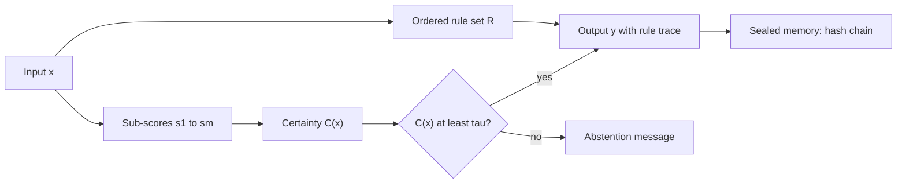

<p align="center">
  
</p>

<p align="center">
  <em>A deterministic, offline inference core with explicit abstention</em><br>
  <strong>TR-2026-QUAD-0018</strong> · version 2.3 · draft for academic review
</p>

<p align="center">
  <a href="https://doi.org/10.5281/zenodo.23964487"></a>
  <a href="https://creativecommons.org/licenses/by-nc-nd/4.0/"></a>
  <a href="https://orcid.org/0009-0005-1982-7176"></a>
  
  
</p>

<p align="center">
  
  
  
</p>

---

## Contents

- [Abstract](#abstract)
- [French summary](#french-summary)
- [The four quadrants](#the-four-quadrants)
- [Architecture](#architecture)
- [The five elements](#the-five-elements)
- [Governance and validation](#governance-and-validation)
- [Requirements](#requirements)
- [Inference and abstention](#inference-and-abstention)
- [Sealed memory and purge](#sealed-memory-and-purge)
- [Evaluation protocol](#evaluation-protocol)
- [Limitations](#limitations)
- [Related work](#related-work)
- [Products and status](#products-and-status)
- [Identifiers, proofs and licence](#identifiers-proofs-and-licence)
- [Version history](#version-history)
- [References](#references)

Status legend used below:  not yet measured ·  not yet fully defined ·  recorded but not checked ·  independently confirmed

---

## Abstract

This repository is the public showcase of the QUAD SYSTEM AI architecture. It documents a rule-based inference core that runs offline, with an explicit abstention rule, a hash-chained memory with session purge, five domain elements and a governance layer. The document separates what is designed from what must still be measured, and it states what is not claimed. Selective classification, certainty-factor scoring and hash-chain time-stamping are established techniques. The contribution claimed is their specific combination and instantiation, which has not yet been evaluated. The software core is not published; this repository publishes the specification and the evidence of dating only.

## French summary

DHIKRA-IMMORTEL-AI est la vitrine publique de l'architecture QUAD SYSTEM AI (TR-2026-QUAD-0018). Elle décrit un noyau d'inférence déterministe, hors ligne, avec une règle d'abstention explicite, une mémoire à chaîne de hachage avec purge de session, cinq éléments fonctionnels et une couche de gouvernance. Le code du noyau n'est pas publié : ce dépôt publie la spécification et les preuves de datation. Aucune priorité n'est revendiquée au-delà de la combinaison décrite.

## The four quadrants

The quadrants are transverse design axes applied to the core and to each module. They do not count modules.

| Quadrant | Design role, as stated by the author |
|---|---|
| **Q1 SOURCE** | Values, intention, sealed memory, and the RAHMA (رحمة) cultural-alignment protocol |
| **Q2 LOGIC** | Local offline language model: text, then plan, then instruction; MICAE reasoning  |
| **Q3 VISION** | Predictive world modelling with latent embeddings of the V-JEPA 2 type; anticipation at t+1 to t+3  |
| **Q4 ACTION** | Robotic arm (Franka) with kinematic planning; execution subordinated to the ILM tablet and sealed through CCSS  |

Learned components (Q2, Q3, Q4) are outside the determinism claims made in this document.

## Architecture



## The five elements

| Element | Role | Stated constraints |
|---|---|---|
| **N°1 DHIKRA SOURCE** (core, mother application) | Classical, deterministic, offline inference; sealed memory; abstention at τ = 0.85 | No cloud dependency; no online learning; verifiable decisions |
| **N°2 SAHA SCAN AI** | Local reading of food labels | Says "Je ne sais pas" when uncertain; informational only |
| **N°3 ILM LIBERATION TABLET** | Single-application offline tablet; no phone chip, no sound | Network access limited to institutional Wi-Fi  |
| **N°4 TAFSUT AI** | Civil humanitarian drone | No offensive function; onboard processing; regulatory compliance  |
| **N°5 TUDERT YIWEN** (formerly THUDERT 1) | Veterinary decision support in Kabyle, Arabic and French | Does not replace a veterinarian; field validation  |

## Governance and validation

- **CCSS, Contrôle, Certification et Scellage Sécurisé.** Sealing by cryptographic fingerprints; certification of action orders by the Respect-Check ethical filter and by human validators; traceability of decisions made by the orchestrating core.
- **MICAE protocol.** A memory entry is treated as valid only when human, animal and environmental validators agree; DHIKRA then seals it.
- **Consent governance.** The local community decides. The local council gives its assent, which is mandatory for any critical use. Cultural alignment runs through SOURCE and the RAHMA protocol. Anyone may object before a memory is sealed.
- **Respect-Check.** An ethical check showing green, orange or red, used to filter action orders and memory entries.

## Requirements

| ID | Requirement | Status |
|---|---|---|
| REQ-1 | **Determinism.** Identical input, software version, configuration and rule set give identical output. |  |
| REQ-2 | **Traceability.** Each output records the identifiers of the rules applied, in order. |  |
| REQ-3 | **Abstention.** If C(x) is below τ, the system returns the abstention message and no substantive answer. | Specified |
| REQ-4 | **Integrity of sealed memory.** Validated entries are append-only and hash-chained, so modification is detectable. |  |
| REQ-5 | **Session purge.** Transient session data is deleted on request. |  |
| REQ-6 | **Offline operation.** No outbound connection during operation, except the institutional scope of N°3. |  |

## Inference and abstention

Let $x$ be an input and $R = \{r_1, \dots, r_n\}$ a finite, validated rule set. The output is the ordered application of the rules:

$$y = R(x)$$

The certainty score aggregates verifiable sub-scores: $s_1$ measures the completeness of the input, $s_2$ the exact match to the rules, and $s_3$ the absence of ambiguity.

$$C(x) = g\big(s_1(x), \dots, s_m(x)\big) \in [0, 1]$$

The abstention rule uses the threshold $\tau$:

$$C(x) < \tau \;\Rightarrow\; \text{abstain}, \qquad \tau = 0.85$$

The value $\tau = 0.85$ is an uncalibrated design choice. It must be set from a risk-coverage analysis on a held-out labelled set. Abstention limits unsupported answers; it does not make the answers given correct, so error rates among answered inputs must be reported separately.

## Sealed memory and purge

Validated entries form an append-only hash chain:

$$h_i = H\big(e_i \,\|\, h_{i-1}\big)$$

Modifying any entry changes every later hash. This gives tamper evidence, not confidentiality. Session data is kept apart and deleted on request; a purge is verified by inspecting every storage location.

## Evaluation protocol

| Property | Metric | Status |
|---|---|---|
| Determinism (REQ-1) | Share of runs whose output hash equals the reference hash, across configurations |  |
| Calibration of τ | Risk-coverage curve and area under it (AURC), on a held-out set |  |
| Selective accuracy | Error rate and coverage at τ |  |
| Memory integrity (REQ-4) | Detection rate of injected modifications |  |
| Purge completeness (REQ-5) | Residual session artifacts after purge |  |
| Offline operation (REQ-6) | Outbound connections over a defined period |  |
| Element-level performance | Task-specific metrics on labelled datasets |  |

Independent replication by a party other than the designer is recommended before strong claims are made.

## Limitations

- Determinism is specified for the rule-based core only. Learned components are out of scope.
- Abstention reduces unsupported answers. It does not prevent errors on answered inputs.
- τ = 0.85 is an uncalibrated design choice.
- No formal verification has been performed. Security properties require an explicit threat model and testing, and are not asserted here.
- Domain performance depends on datasets that have not yet been described.
- Regulatory compliance (civil drone rules for N°4; food-information and veterinary rules for N°2 and N°5) has not been evaluated. No certification or regulatory approval is claimed.
- The software core is not published. This repository gives the specification and the evidence of dating, not the code.

## Related work

Chow (1970) analysed the reject option. El-Yaniv and Wiener (2010) formalised selective classification in terms of risk and coverage, and Geifman and El-Yaniv (2017) extended it to deep networks. Certainty-factor reasoning appears in rule-based expert systems (Shortliffe and Buchanan, 1975). Hash-chained time-stamping was proposed by Haber and Stornetta (1991). No systematic literature review has yet been carried out, so no priority claim beyond the specific combination is made.

## Products and status

| Product | Description | Status |
|---|---|---|
| **DHIKRA SOURCE** | Core application; sealed memory; Respect-Check | Specification published; core not released |
| **Système Pinal** | Flutter/Dart interface in black and gold; Respect-Check; DHIKRA memory; keyboard with no voice and no sound | Prototype; evaluation licence, and commercial licence on quotation |
| **IMMORTEL AI** | Photo animation: eyes and a gentle mouth movement only; reuse of the concept requires a paid commercial licence | Public README |
| **SAHA SCAN AI** | Mobile food-label reader, green, orange and red levels | Design sheet dated 16/10/2026 |
| **ILM LIBERATION TABLET** | Single-application offline tablet for institutional networks | Design sheet N°03 dated 17/10/2026; proof-of-concept reference ILM-TABLET-2626-POC |
| **TAFSUT AI** | Civil humanitarian drone, 250 g class design target |  |
| **TUDERT YIWEN** | Portable veterinary diagnostic aid with four sensors and embedded AI |  |

## Identifiers, proofs and licence

**Author.** Yassa Yacine Cheurfa, independent designer of ethical AI architectures. ORCID [0009-0005-1982-7176](https://orcid.org/0009-0005-1982-7176).

**Zenodo DOIs.**

| Version | Date | DOI |
|---|---|---|
| v2.3 (current) | 05/11/2026 | [10.5281/zenodo.23964487](https://doi.org/10.5281/zenodo.23964487) |
| v2.1 | 31/10/2026 | [10.5281/zenodo.23847692](https://doi.org/10.5281/zenodo.23847692) |
| v2.0 | 28/10/2026 | [10.5281/zenodo.23717622](https://doi.org/10.5281/zenodo.23717622) |
| v1.1 | 27/10/2026 | [10.5281/zenodo.23690395](https://doi.org/10.5281/zenodo.23690395) |
| v1.0 | 26/10/2026 | [10.5281/zenodo.23671063](https://doi.org/10.5281/zenodo.23671063) |
| All versions | | [10.5281/zenodo.23671062](https://doi.org/10.5281/zenodo.23671062) |

<details>
<summary><strong>Bitcoin timestamps (OpenTimestamps), SHA-256 prefixes</strong></summary>

Each file is hashed with SHA-256 and anchored to the Bitcoin blockchain through OpenTimestamps. Only the first characters of each hash are listed.

| File | SHA-256 (start) | Status |
|---|---|---|
| FICHE_TECHNIQUE_DHIKRA_v2.3.pdf | `8a7d70cb6be8…` |  block 974594, 04/11/2026 |
| DhikraNotary.sol (contract not deployed) | `a7de43a9…` |  |
| Dhikra_V2_TOUT_EN_UN.png.png | `90f16f819e63…` |  |
| DHIKRA-IMMORTEL-AI-v1.1.zip | `8e5f9b6f3e11…` |  |
| README_OFFICIEL.md certificate | `95d69e77db9a…` |  |
| HASHES.txt (official package) | `51a05969ecf6…` |  |
| QUAD_SYSTEM_AI_schema_corrige-2.png | `8a05932c0cf9…` |  |

A certificate for version 2 was also time-stamped under RFC 3161 (FreeTSA) on 24/10/2026. 

</details>

**Licence.** Texts and visuals: CC BY-NC-ND 4.0. Software, algorithms, model weights and unpublished documentation: proprietary and closed. Copying, modification, redistribution, commercial use, derivative works, reverse engineering and AI training require a signed written licence from the author. Commercial terms are available on written request.

> Attribution: *QUAD SYSTEM AI © Yassa Yacine Cheurfa, TR-2026-QUAD-0018*.
>
> Reserved names: QUAD SYSTEM AI, DHIKRA SOURCE, SAHA SCAN, ILM, TAFSUT AI, TUDERT YIWEN.
>
> Protection in five layers: copyright; closed code and secrets; reserved names; licences; evidence of priority. Limits are stated openly in the Limitations section.

**Licence requests.** [dhikraemmortel@proton.me](mailto:dhikraemmortel@proton.me)

**Usage matrix for academic researchers.** The matrix is the author's own creation: green means reading and citation are free with attribution; orange means prior written authorisation is required; red means prohibited.

**Citation.**

```bibtex
@misc{cheurfa2026dhikra,
  author    = {Cheurfa, Yassa Yacine},
  title     = {DHIKRA-IMMORTEL-AI, version 2.3},
  year      = {2026},
  publisher = {Zenodo},
  doi       = {10.5281/zenodo.23964487},
  note      = {TR-2026-QUAD-0018}
}
```

## Version history

| Version | Date | Change |
|---|---|---|
| v1.0 | 26/10/2026 | First public release of the repository |
| v1.1 | 27/10/2026 | CCSS documentation added; licence set to CC BY-NC-ND 4.0 on 28/10/2026 |
| v2.0 | 28/10/2026 | Structured README and copyright notice |
| v2.1 | 31/10/2026 | Showcase release without source code, published on GitHub on 01/11/2026 |
| v2.3 | 05/11/2026 | Academic reorganisation of the README and specification; fiche technique v2.3 time-stamped |

## References

1. Cheurfa, Y. Y. (2026). *DHIKRA-IMMORTEL-AI*, version 2.3 [Software documentation]. Zenodo. https://doi.org/10.5281/zenodo.23964487
2. Chow, C. K. (1970). On optimum recognition error and reject tradeoff. *IEEE Transactions on Information Theory*, 16(1), 41–46.
3. El-Yaniv, R., & Wiener, Y. (2010). On the foundations of noise-free selective classification. *Journal of Machine Learning Research*, 11, 1605–1641.
4. Geifman, Y., & El-Yaniv, R. (2017). Selective classification for deep neural networks. *Advances in Neural Information Processing Systems*, 30.
5. Haber, S., & Stornetta, W. S. (1991). How to time-stamp a digital document. *Journal of Cryptology*, 3(2), 99–111.
6. Shortliffe, E. H., & Buchanan, B. G. (1975). A model of inexact reasoning in medicine. *Mathematical Biosciences*, 23(3–4), 351–379.

---

<p align="center">
  Copyright © 2026 Yassa Yacine Cheurfa · Texts and visuals under CC BY-NC-ND 4.0 · Software proprietary and closed
</p>
