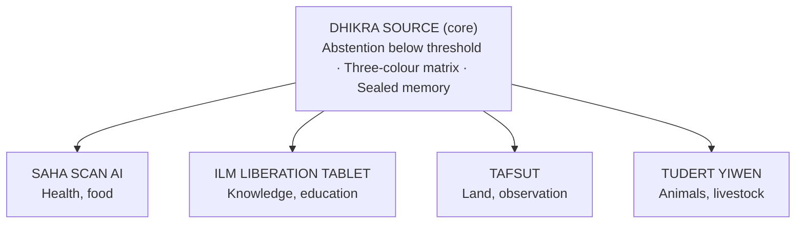

<p align="center">
  
</p>

<p align="center"><sub><b>Figure 1.</b> Le feu tricolore, aiguille de la balance éthique du QUAD SYSTEM AI.</sub></p>

# QUAD SYSTEM AI — DHIKRA IMMORTEL AI

**Version 2.3**

> **IA classique** : IA locale, hors ligne, sans cloud, sans apprentissage en ligne. Chaque décision est vérifiable.

## ⚖️ Philosophie

Une IA juste n'est pas une IA qui décide à la place de l'humain. C'est une IA qui pèse. Sur un plateau, la puissance de la machine. Sur l'autre, le droit, la dignité et la liberté de la personne. Rien n'avance tant que la balance n'est pas équilibrée.

Le feu tricolore est l'aiguille de cette balance : vert, la décision est juste, on avance. Orange, le doute, un humain doit trancher. Rouge, la balance penche contre la personne, l'action est interdite.

---

## N°1 — DHIKRA SOURCE

Application mère. Protocole éthique, mémoire scellée.
Règle d'abstention : si la confiance est inférieure à 0,85, l'IA s'abstient et le dit.

DHIKRA-IMMORTEL-AI est l'application de DHIKRA SOURCE pour conserver le souvenir, avec respect.

**⚖️ Justice : la mémoire est pesée avant d'être scellée.** Le souvenir est protégé, et l'IA s'abstient quand elle doute.

**Points forts**
- **Respect-Check** : un feu tricolore (vert, orange, rouge) qui valide chaque usage avant qu'il ait lieu.
- **Mémoire scellée** : empreintes cryptographiques et validation humaine (CCSS).
- **Photo vivante, toute en douceur** : seulement l'ouverture et la fermeture des yeux, et un léger mouvement de bouche.
- **Clavier sans voix et sans son**, par respect.

## N°2 — SAHA SCAN AI

Scan alimentaire. Lecture des étiquettes sur le téléphone, sans envoi à un serveur.
Si elle n'est pas sûre, elle répond « Je ne sais pas ».

**⚖️ Justice : la vérité à égalité pour tous.** Chacun voit la même composition et choisit librement.

**Points forts**
- **Composition du produit lue en temps réel**, niveaux vert, orange, rouge.
- **Pas de punition, juste la vérité pour choisir** : l'utilisateur garde le choix libre.
- **Aucune donnée envoyée** : tout reste sur le téléphone.

## N°3 — ILM LIBÉRATION TABLET

Tablette éducative mono-application. WiFi contrôlé des institutions uniquement.
Une seule fonction : apprendre. Pas de puce téléphone, pas de haut-parleur, pas de son, pas d'autre application.

**⚖️ Justice : le savoir est un droit, pas un privilège.** Le même accès à l'apprentissage, pour chacun.

**Points forts**
- **Le droit de savoir pour tout le monde** : écoles et institutions, y compris pour les personnes détenues.
- **Unité de contrôle hors ligne** (air-gapped).
- **Validation par le conseil local** : passerelle à matrice tricolore (vert autorisé, orange validation selon le contexte, rouge interdit).
- **Pas un téléphone** : aucune distraction possible.

## N°4 — TAFSUT AI

Drone civil humanitaire de nouvelle génération. Observation, aide et secours. Aucune fonction offensive.
L'analyse se fait dans le drone. Aucune image n'est envoyée sur Internet. Seules de courtes alertes sont transmises, en local.

**⚖️ Justice : voir pour protéger, jamais pour punir.** L'observation est consentie et la vie privée reste intacte.

**Points forts**
- **Détection des incendies** par imagerie thermique, pour l'agriculture et l'humanitaire.
- **Observation éthique** : surveillance consentie, anonymat garanti.
- **Autonome** : énergie solaire, fonctionne sans Internet.

## N°5 — TUDERT YIWEN (anciennement THUDERT 1)

Aide au diagnostic vétérinaire pour les animaux et les éleveurs.
Réseau WiFi local, sans Internet. En kabyle, arabe et français.
Aide l'éleveur, ne remplace pas le vétérinaire.

**⚖️ Justice : l'équilibre entre l'outil et le métier.** La machine éclaire, l'éleveur et le vétérinaire décident.

**Points forts**
- **Quatre capteurs** : optique (SpO2, rythme cardiaque, respiration) et imagerie thermique.
- **Résultat simple** : alerte verte, orange ou rouge, compréhensible tout de suite.
- **Robuste et léger** : environ 280 g, étanche IP67, fait pour la ferme.
- **Parle la langue de l'éleveur** : kabyle, arabe, français.

---

## Auteur

**Yassa Yacine Cheurfa**
Concepteur indépendant d'architectures d'IA éthique
Auteur-concepteur de DHIKRA QUAD SYSTEM AI


<div align="center">

# DHIKRA-IMMORTEL-AI

### DHIKRA QUAD SYSTEM AI — An Offline, Ethics-by-Design AI Architecture under Human Supervision

**Refs. TR-2026-QUAD-0018 · TR-2026-TRIPLE-0017**

*Public academic presentation. NO SOURCE CODE.*

[](https://doi.org/10.5281/zenodo.23964487)
[](https://doi.org/10.5281/zenodo.23964487)
[](https://creativecommons.org/licenses/by-nc-nd/4.0/)
[](https://opentimestamps.org)
<!-- ORCID badge: add your ORCID iD link here -->

**Author and rights holder:** Yassa Yacine Cheurfa, Azazga, Algeria
**© 2026 Yassa Yacine Cheurfa. All rights reserved on the technology.**

</div>

---

## Contents

- [Part I. Overview](#part-i-overview)
- [Part II. White Paper](#part-ii-white-paper)
- [Part III. Reference Sheet](#part-iii-reference-sheet)
- [About the author](#about-the-author)
- [How to cite](#how-to-cite)

---

# Part I. Overview

## Ethics by design

Ethics by design means building moral values, safety rules and ethical principles directly into the architecture of a computer system or an artificial intelligence, from the very first phase of development.

In the **DHIKRA QUAD SYSTEM AI**, this means:

- **The system does not kill; it observes.**
- **The system does not lie:** if its confidence level is below 0.85, it answers *"I don't know."*
- **The system does not steal:** it stays offline, local and sovereign.

## Triple-licence ecosystem (Ref. TR-2026-TRIPLE-0017)

| Module | Description | Reference |
|---|---|---|
| **DHIKRA SOURCE** | Ethical protocol, sealed memory | VID-20261009-WA0051 |
| **SAHA SCAN AI** | Offline food analysis | SAHA-20261015-WA0052 |
| **ILM LIBERATION TABLET** | Sovereign single-application tablet | ILM-20261017-WA0053 |

This triptych forms the basis of the AI architecture of the DHIKRA QUAD system (reference sheet TR-2026-QUAD-0018).

## Principles

- **P1 — Presentation without source code.** Only the academic description is public. No source code, internal architecture or manufacturing detail is disclosed.
- **P2 — Closed proprietary technology.** No commercial exploitation right is granted without the written agreement of the author.

## Licence

This presentation (texts and visuals) is published under **CC BY-NC-ND 4.0**: non-commercial sharing, with attribution to the author, without modification. The underlying technology remains the property of the author and its use is protected.

**Reserved names:** DHIKRA SOURCE, SAHA SCAN AI, ILM LIBERATION TABLET, QUAD SYSTEM AI.

Any reuse or citation must credit the author and include a link to this original repository.

## Evidence of prior art

| Item | Value |
|---|---|
| DOI (Zenodo) | [10.5281/zenodo.23964487](https://doi.org/10.5281/zenodo.23964487) |
| SHA-256 of `index.html` | `2cdf852837b6c55063f5999df16d6665bacf34c7efd317a384ca5ad150cbaec2` |
| Bitcoin timestamp | `index.html.ots` (verifiable at [opentimestamps.org](https://opentimestamps.org)) |
| `DhikraNotary.sol` | Timestamped on Bitcoin (`DhikraNotary.sol.ots`); **not deployed** on any blockchain. SHA-256: `[FULL 64-CHARACTER HASH]` |

## Contact for licence requests

**dhikraemmortel@proton.me**

> **NOTICE:** this repository contains **no source code**. Any request for code, internal architecture or manufacturing details will be declined.

---

# Part II. White Paper

## DHIKRA QUAD SYSTEM AI

*An offline AI architecture, designed according to ethical principles and under human supervision.*

**Author:** Yassa Yacine Cheurfa, independent author, Azazga (Algeria)
**References:** TR-2026-QUAD-0018 · TR-2026-TRIPLE-0017 · DOI 10.5281/zenodo.23964487
**Version:** 1.0, November 2026. Public version, without source code. Published with demonstration version 2.3 (DOI 10.5281/zenodo.23964487).
**Text licence:** CC BY-NC-ND 4.0. The underlying technology remains the property of the publisher.
**Contact:** dhikraemmortel@proton.me

### Abstract

We present **DHIKRA QUAD SYSTEM AI**, a family of offline AI components built on one founding principle: ethics is an intrinsic property of the architecture, not an add-on. It comprises an ethical core and four application modules.

The name **QUAD** refers to the four cross-cutting quadrants — **SOURCE, LOGIC, VISION, ACTION** — which apply to the core of the system and to each module. It does not refer to the number of modules. These quadrants are described in detail in Part III, section 4.3.

Two cross-cutting mechanisms implement this requirement. The first is **abstention**: below a confidence threshold of 0.85, the system answers *"I don't know."* The second is a **three-colour matrix** (green, orange, red) that makes every sensitive action conditional on human validation.

This paper presents the design requirements, the conceptual architecture, the modules, a proposed evaluation protocol and the known limitations. It reports **no experimental results**; it states verifiable hypotheses.

**Keywords:** ethics by design; offline AI; selective abstention; human oversight; data sovereignty; embedded AI.

### 1. Introduction

Consumer AI systems generally depend on a remote service, answer even when their confidence is low, and treat ethics as a layer added after design.

Three consequences follow: data leaves the device, errors are delivered with apparent certainty, and safeguards are easier to bypass than if they were structural.

These limits weigh most where connectivity is weak, hardware is modest and decisions are urgent, for example in rural or school settings.

This work proposes an architectural answer. It makes four contributions:

1. five design requirements that turn ethics into verifiable properties (Section 3);
2. two cross-cutting mechanisms, abstention below a threshold and a three-colour matrix (Section 5);
3. a modular architecture made of a core and four modules inheriting its rules (Sections 3 and 4);
4. a falsifiable evaluation protocol (Section 6).

The contribution lies in the integration and formalisation of principles, not in a new algorithm. Module performance is not presented here.

### 2. Related work

**Ethics by design.** Value Sensitive Design integrates human values into the technical design process [1]. *Privacy by Design* proposes a privacy-first approach [2]. The European guidelines for trustworthy AI [3] and the UNESCO Recommendation on the Ethics of AI [4] set out similar principles. Jobin, Ienca and Vayena find, across more than eighty documents, convergence on principles but little consensus on their implementation [5]. DHIKRA addresses the second problem: turning principles into architectural mechanisms.

**Selective abstention.** The idea of a classifier that refuses to answer under uncertainty goes back to Chow's reject option [6] and was taken up for deep networks as selective classification [7]. A confidence threshold only makes sense if confidence is calibrated, yet modern networks are often poorly calibrated [8]. DHIKRA's 0.85 threshold is therefore a hypothesis to be validated module by module, not a guarantee.

**Embedded AI.** Running models on resource-constrained devices is documented in the TinyML literature [9] and by dedicated runtimes [10]. It makes offline operation possible, at the price of smaller models than large remote ones.

### 3. Design requirements and architecture

Ethics by design is broken down here into five requirements, each formulated so that it can be verified.

| Requirement | Target property | Proposed verification |
|---|---|---|
| **R1 — Non-harm** | No module has an offensive function; observation is the default behaviour. | Specification review: no function acts against a person |
| **R2 — Truthfulness** | Below the confidence threshold (0.85), the system abstains. | Abstention rate and selective risk measured on a test set |
| **R3 — Sovereignty** | Inference and storage stay local; the main function requires no network. | Network-off test: function maintained, no outgoing traffic |
| **R4 — Human control** | Every sensitive action is subject to human validation (three-colour matrix). | No execution path bypasses validation |
| **R5 — Memory integrity** | History is sealed. | Any alteration of the history is detectable |

The architecture is modular. The **DHIKRA SOURCE** module is its core: it embeds the ethical protocol and the sealed memory. Four application modules inherit from it, each covering one domain. A module can change domain without its rules being modified.

| Module | Domain | Reference |
|---|---|---|
| DHIKRA SOURCE | Ethics, memory, truth | VID-20261009-WA0051 |
| SAHA SCAN AI | Health, food | SAHA-20261015-WA0052 |
| ILM LIBERATION TABLET | Knowledge, education | ILM-20261017-WA0053 |
| TAFSUT | Land, observation | TAFSUT-20261018 |
| TUDERT YIWEN (formerly THUDERT 1) | Animals, livestock | — |

This document considers only the core module and the four application modules above. The complementary PENTA and executive modules, listed in Part III (section 4.4), belong to the wider ecosystem and are not covered here.



*Figure 1. The DHIKRA SOURCE core embeds the three common mechanisms (abstention below a threshold, three-colour matrix, sealed memory); each application module inherits them. All run offline and locally (R3), with no offensive function (R1).*

### 4. The modules

Each module is described conceptually: the problem it addresses, the principle of the solution and the documented state of progress. No internal detail is published.

#### 4.1 DHIKRA SOURCE — the ethical core

- **Problem.** The ethical behaviour of a system is rarely verifiable, because it rests on instructions hidden inside a model.
- **Principle.** DHIKRA SOURCE uses the common protocol: abstention threshold (R2), three-level control (R4) and sealed memory (R5). It guarantees predictable behaviour to the other modules.
- **State.** Concept and application documented; proof of prior art dated 13 October 2026.

#### 4.2 SAHA SCAN AI — reading food labels

- **Problem.** Labels are dense and technical, and existing tools require a network and the sending of images to servers.
- **Principle.** Analysis is local (R3). The result is displayed on three colour levels, following a principle of non-coercive information: give the truth so that users can choose, without penalising them. When uncertain, the application abstains (R2).
- **State.** Technical sheet dated 16 October 2026.

#### 4.3 ILM LIBERATION TABLET — knowledge on a dedicated device

- **Problem.** General-purpose devices scatter attention and expose students' data.
- **Principle.** A single-application tablet with offline AI and a controlled institutional network. A local council validates content using a three-colour matrix: green (allowed), orange (subject to contextual validation), red (forbidden — R4).
- **State.** Technical sheet No. 03 of 17 October 2026.

#### 4.4 TAFSUT — observation without violence

- **Problem.** Early fire detection is difficult in remote wooded areas where the network is insufficient.
- **Principle.** A drone observation module designed with no offensive capability (R1), with on-board processing (R3). Observation respects privacy: surveillance with consent, guaranteed anonymity. Any decision taken following an observation is subject to a human (R4).
- **State.** Design documented (technical diagram, software simulation of behaviour).

#### 4.5 TUDERT YIWEN (formerly THUDERT 1) — veterinary diagnosis support

- **Problem.** In livestock farming, the veterinarian is sometimes far away and diseases are detected late.
- **Principle.** A portable device combining several sensors and embedded AI provides a first estimate on three confidence levels, in Kabyle, Arabic and French. It is a decision aid, not a diagnosis: below the confidence threshold, it recommends a consultation (R2).
- **State.** Design presented.

#### 4.6 Associated project: DHIKRA-IMMORTEL-AI

DHIKRA-IMMORTEL-AI applies the same principle of restraint to the preservation of memories. It animates a photograph in a simple frame, under a deliberate constraint: movement is limited to opening and closing the eyes and a movement of the mouth, all done gently. This limit illustrates R1: what the system cannot do is an integral part of its design.

### 5. Cross-cutting mechanisms

#### 5.1 Abstention below a threshold

Let *x* be an input, ŷ(*x*) the model's answer and *c*(*x*) its confidence level. The decision *d*(*x*) follows the rule below, with τ = 0.85:

$$
d(x)=
\begin{cases}
\hat{y}(x) & \text{if } c(x)\ge\tau\\
\text{"I don't know"} & \text{otherwise}
\end{cases}
$$

This rule favours reliability at the expense of coverage. It is characterised by two quantities: **coverage**, the proportion of inputs the system answers, and **selective risk**, the error rate on the inputs actually handled [7]. The value 0.85 is meaningful only if *c*(*x*) is calibrated [8]; it must therefore be established for each module.

#### 5.2 Three-colour matrix

The three-colour matrix is an original implementation by the author; similar systems exist, and the author's contribution lies in its combination with community governance and offline operation (see Part III, sections 3 and 9). It assigns each action or use one of three levels.

| Level | Meaning | Effect on the system |
|---|---|---|
| 🟢 **Green** | Allowed | The action runs or the content is displayed. |
| 🟠 **Orange** | Validation required | Human validation is needed before execution. |
| 🔴 **Red** | Forbidden | The action is blocked. |

The same grid applies to uses of this document: free reading and citation (green), prior written authorisation (orange), forbidden use (red).

#### 5.3 Combination

The two mechanisms are complementary. Below the threshold, the system abstains whatever the colour of the action. Above the threshold, the colour decides: an orange action waits for a person's validation, while a red action is blocked. Human intervention thus remains the last link in the chain for any sensitive decision.

### 6. Proposed evaluation protocol

This section describes how requirements R1 to R5 will be tested. It defines hypotheses that can be refuted.

**Hypotheses.**

- **H1:** with τ = 0.85, the selective risk of each module is lower than its error rate without abstention.
- **H2:** the main function of each module is maintained when the network is off, with no outgoing traffic.
- **H3:** no red action is executable and no orange action runs without human validation.
- **H4:** any alteration of the history is detected in the tested cases.

**Metrics.**

| Metric | Hypothesis | Method |
|---|---|---|
| Coverage and selective risk | H1 | Risk–coverage curve on a test set specific to each module [7] |
| Calibration error | H1 | Gap between confidence and accuracy [8] |
| Outgoing traffic | H2 | Network capture during use, network on then off |
| Latency and energy consumption | H2 | Measurements on the target hardware |
| Bypass attempts | H3 | Adversarial tests of execution paths |
| Tamper detection | H4 | Deliberate modification of the history, then verification |

**Validity conditions.** Acceptance thresholds are fixed before measurement. The protocol is timestamped before the experiment, then published with the results, whether favourable or not. Test datasets are described, and sensitive modules (veterinary diagnosis, drone observation) are assessed by specialists of the field.

### 7. Intellectual property and provenance

**Distribution model.** This text and its visuals are published under CC BY-NC-ND 4.0: non-commercial sharing, with attribution, without modification. The underlying technology is proprietary and closed. No commercial exploitation right is granted without the written agreement of the author. Reserved names: DHIKRA SOURCE, SAHA SCAN AI, ILM LIBERATION TABLET, QUAD SYSTEM AI.

**Provenance.** The existence of the documents at a given date is established by a Zenodo DOI (10.5281/zenodo.23964487), by SHA-256 hashes, by timestamps anchored in the Bitcoin blockchain via OpenTimestamps [12][13], and by RFC 3161 timestamps [11]. These elements attest to the existence of a file at a given moment. On their own they do not constitute proof of authorship or ownership of rights: they form a body of evidence that complements the copyright attached to the work by law.

### 8. Limitations and threats to validity

- **No results.** The modules are at the stage of documented design. No performance is reported and none should be inferred from this text.
- **Single threshold.** The 0.85 threshold is a starting hypothesis. It may be too strict for one module and too permissive for another.
- **External verification.** Keeping the code closed protects the author but limits independent verification. Public test protocols and audits under a confidentiality agreement can partly compensate.
- **Local models.** An embedded model is less capable than a large remote one. The choice between reliability and abstention has a cost in coverage.
- **Low-resource languages.** The quality of a Kabyle interface depends on linguistic resources scarcer than those for French or Arabic, which can create performance gaps between languages.
- **Regulated domains.** Drones and diagnostic devices fall under their own rules, to be integrated before any real use.

### 9. Future work and conclusion

The next steps follow the protocol in Section 6:

1. fix and timestamp the acceptance thresholds of each module;
2. calibrate confidence and determine the threshold suited to each module;
3. build prototypes and publish the measurements, favourable or not;
4. have the sensitive modules assessed by specialists of the field.

DHIKRA QUAD SYSTEM AI defends the idea that a trustworthy AI knows how to say it does not know, keeps data with the person and leaves the human to decide. This paper turns that idea into verifiable requirements, architectural mechanisms and refutable hypotheses. Its value will be judged by the measurements that follow, and the protocol is designed so that they are published whatever the outcome.

### White paper references

1. B. Friedman, P. H. Kahn Jr., A. Borning, "Value Sensitive Design and Information Systems", in K. E. Himma and H. T. Tavani (eds.), *The Handbook of Information and Computer Ethics*, Wiley, 2008.
2. A. Cavoukian, *Privacy by Design: The 7 Foundational Principles*, Information and Privacy Commissioner of Ontario, 2009.
3. High-Level Expert Group on AI, *Ethics Guidelines for Trustworthy AI*, European Commission, 2019.
4. UNESCO, *Recommendation on the Ethics of Artificial Intelligence*, 2021.
5. A. Jobin, M. Ienca, E. Vayena, "The global landscape of AI ethics guidelines", *Nature Machine Intelligence*, 1, 2019, pp. 389–399.
6. C. K. Chow, "On optimum recognition error and reject tradeoff", *IEEE Transactions on Information Theory*, 16(1), 1970, pp. 41–46.
7. Y. Geifman, R. El-Yaniv, "Selective Classification for Deep Neural Networks", *Advances in Neural Information Processing Systems 30*, 2017.
8. C. Guo, G. Pleiss, Y. Sun, K. Q. Weinberger, "On Calibration of Modern Neural Networks", *ICML*, 2017.
9. P. Warden, D. Situnayake, *TinyML*, O'Reilly Media, 2019.
10. R. David et al., "TensorFlow Lite Micro: Embedded Machine Learning for TinyML Systems", *MLSys*, 2021.
11. C. Adams, P. Cain, D. Pinkas, R. Zuccherato, *RFC 3161: Internet X.509 Public Key Infrastructure Time-Stamp Protocol (TSP)*, IETF, 2001.
12. S. Nakamoto, *Bitcoin: A Peer-to-Peer Electronic Cash System*, 2008.
13. OpenTimestamps, <https://opentimestamps.org>.

---

# Part III. Reference Sheet

<!-- Insert Part III (Reference Sheet) here. -->

---

## About the author

**Yassa Yacine Cheurfa** is an independent designer based in Azazga, Algeria, specialising in the design of ethical artificial intelligence architectures. He is the author and designer of the **DHIKRA QUAD SYSTEM AI**.

---

## How to cite

```bibtex
@misc{cheurfa2026dhikra,
  author       = {Cheurfa, Yassa Yacine},
  title        = {{DHIKRA QUAD SYSTEM AI}: An Offline, Ethics-by-Design AI Architecture under Human Supervision (White Paper, v1.0)},
  year         = {2026},
  howpublished = {Zenodo},
  doi          = {10.5281/zenodo.23964487}
}
```

---

<div align="center">

© 2026 Yassa Yacine Cheurfa. Text licensed under [CC BY-NC-ND 4.0](https://creativecommons.org/licenses/by-nc-nd/4.0/). The underlying technology remains the property of the author.

</div>
