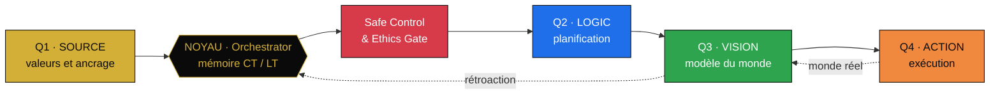

# Livre blanc — DHIKRA QUAD SYSTEM AI

*Une architecture d'intelligence artificielle éthique par conception, hors ligne et sous contrôle humain*

**Auteur :** Yassa Yacine Cheurfa, auteur indépendant, Azazga (Algérie)  
**Références :** TR-2026-QUAD-0018 · TR-2026-TRIPLE-0017 · DOI 10.5281/zenodo.23964487  
**Version :** 1.0, novembre 2026. Version publique, sans code source.  
**Licence du texte :** CC BY-NC-ND 4.0. La technologie sous-jacente reste propriétaire.  
**Contact :** dhikraemmortel@proton.me

---

## Résumé

Nous présentons DHIKRA QUAD SYSTEM AI, une famille d'IA fonctionnant hors ligne, qui partage une même exigence : l'éthique est une propriété de l'architecture, pas un ajout. Il comprend un socle éthique et quatre modules applicatifs.

Le nom QUAD désigne quatre quadrants transverses — SOURCE, LOGIC, VISION, ACTION — qui s'appliquent au socle comme à chaque module. Il ne désigne pas le nombre de modules.

Deux mécanismes transverses la mettent en œuvre. Le premier est l'abstention : sous un seuil de confiance fixé à 0,85, le système répond « Je ne sais pas ». Le second est une matrice tricolore (vert, orange, rouge) qui subordonne toute action sensible à une validation humaine.

Ce document précise les exigences de conception, l'architecture conceptuelle, les modules, un protocole d'évaluation et les limites connues. Il ne rapporte aucun résultat expérimental : il formule des hypothèses testables.

**Mots-clés :** éthique par conception ; IA hors ligne ; abstention sélective ; contrôle humain ; souveraineté des données ; IA embarquée.

## Abstract

We present DHIKRA QUAD SYSTEM AI, a family of offline AI elements built on one requirement: ethics is a property of the architecture, not an add-on. It comprises one ethical core and four application modules.

The name QUAD refers to four cross-cutting quadrants — SOURCE, LOGIC, VISION, ACTION — that apply to the core as well as to each module. It does not refer to the number of modules.

Two cross-cutting mechanisms implement it. The first is abstention: below a confidence threshold of 0.85, the system answers "I don't know". The second is a three-colour matrix (green, orange, red) that makes any sensitive action depend on human validation.

This paper states the design requirements, the conceptual architecture, the modules, a proposed evaluation protocol and the known limitations. It reports no experimental results; it states testable hypotheses.

**Keywords:** ethics by design; offline AI; selective abstention; human oversight; data sovereignty; embedded AI.

---

## 1. Introduction

Les systèmes d'IA grand public dépendent en général d'un service distant, répondent même quand leur confiance est faible, et traitent l'éthique comme une couche ajoutée après la conception.

Trois conséquences en découlent : les données quittent l'appareil, les erreurs sont présentées avec assurance, et les garde-fous se contournent plus facilement que s'ils étaient structurels.

Ces limites pèsent davantage là où la connexion est faible, le matériel modeste et les décisions rapides, par exemple en milieu rural ou scolaire.

Ce travail propose une réponse architecturale. Ses contributions sont au nombre de quatre :
1. cinq exigences de conception qui traduisent l'éthique en propriétés vérifiables (section 3) ;
2. deux mécanismes transverses, l'abstention sous seuil et la matrice tricolore (section 5) ;
3. une architecture modulaire composée d'un socle et de quatre modules héritant de ses règles (sections 3 et 4) ;
4. un protocole d'évaluation falsifiable (section 6).

La contribution est une intégration et une mise en forme de principes, non un nouvel algorithme. Les performances des modules ne sont pas rapportées ici.

---

## 2. État de l'art

**Éthique par conception.** La *Value Sensitive Design* intègre des valeurs humaines dans le processus de conception technique [1]. Le *Privacy by Design* en a donné une déclinaison pour la vie privée [2]. Les lignes directrices européennes pour une IA digne de confiance [3] et la recommandation de l'UNESCO sur l'éthique de l'IA [4] posent des principes proches. Jobin, Ienca et Vayena observent, sur plus de quatre-vingts documents, une convergence sur les principes mais peu de consensus sur leur mise en œuvre [5]. DHIKRA se place sur ce second terrain : traduire les principes en mécanismes d'architecture.

**Abstention sélective.** Le principe d'un classifieur qui refuse de répondre quand il est incertain remonte à l'option de rejet de Chow [6] et a été repris pour les réseaux profonds sous le nom de classification sélective [7]. Un seuil de confiance n'a toutefois de sens que si la confiance est calibrée, or les réseaux modernes le sont souvent mal [8]. Le seuil de 0,85 de DHIKRA est donc une hypothèse à valider module par module, non une garantie.

**IA embarquée.** L'exécution de modèles sur des appareils à ressources limitées est documentée par la littérature TinyML [9] et par des environnements d'exécution dédiés [10]. Elle rend le fonctionnement hors ligne réaliste, au prix de modèles plus contraints que les grands modèles distants.

---

## 3. Exigences de conception et architecture

L'éthique par conception est ici décomposée en cinq exigences. Chacune est formulée de manière à pouvoir être vérifiée.

| Exigence | Propriété visée | Vérification proposée |
| --- | --- | --- |
| R1 Non-nuisance | Aucun module ne possède de fonction offensive ; l'observation est le comportement par défaut | Revue des spécifications : aucune fonction d'action contre une personne |
| R2 Véracité | Sous le seuil de confiance (0,85), le système s'abstient | Taux d'abstention et risque sélectif mesurés sur un jeu de test |
| R3 Souveraineté | Inférence et stockage restent locaux ; la fonction principale ne demande pas de réseau | Test réseau coupé : fonction maintenue, aucun trafic sortant |
| R4 Contrôle humain | Toute action sensible passe par une validation humaine (matrice tricolore) | Aucun chemin d'exécution ne contourne la validation |
| R5 Intégrité de la mémoire | L'historique est scellé | Toute altération de l'historique est détectable |

L'architecture est modulaire. Le module DHIKRA SOURCE constitue le socle : il porte le protocole éthique et la mémoire scellée. Quatre modules applicatifs en héritent et couvrent chacun un domaine. Un module peut changer de domaine sans changer de règles.

| Module | Domaine | Référence |
| --- | --- | --- |
| DHIKRA SOURCE | Éthique, mémoire, vérité | VID-20261009-WA0051 |
| SAHA SCAN AI | Santé, alimentation | SAHA-20261015-WA0052 |
| ILM LIBÉRATION TABLET | Savoir, éducation | ILM-20261017-WA0053 |
| TAFSUT | Terre, observation | TAFSUT-20261018 |
| TUDERT YIWEN (anciennement THUDERT 1) | Animal, élevage | — |

**Figure 1.** Le socle DHIKRA SOURCE porte les


# DHIKRA-IMMORTEL-AI | TR-2026-QUAD-0018 & TR-2026-TRIPLE-0017

**Vitrine publique académique. SANS CODE SOURCE.**

[


](https://doi.org/10.5281/zenodo.23964487)
[


](https://creativecommons.org/licenses/by-nc-nd/4.0/)

**Auteur et titulaire des droits :** Yassa Yacine Cheurfa, Azazga, Algérie
© 2026 Yassa Yacine Cheurfa. Tous droits réservés sur la technologie.

---

### Éthique par conception (Ethics by Design)

## L'éthique par conception consiste à intégrer des valeurs morales, des règles de sécurité et des principes éthiques directement dans l'architecture d'un système informatique ou d'une intelligence artificielle, dès sa toute première phase de développement.

Dans **DHIKRA QUAD SYSTEM AI**, cela signifie :
- Le système ne tue pas, il observe.
- Le système ne ment pas : si la confiance est inférieure à 0,85, il répond « Je ne sais pas ».
- Le système ne vole pas : il reste hors ligne, local et souverain.

---

## Écosystème Triple Licence (Réf. TR-2026-TRIPLE-0017)

1. **DHIKRA SOURCE** (VID-20261009-WA0051) : protocole éthique, mémoire scellée
2. **SAHA SCAN AI** (SAHA-20261015-WA0052) : scan alimentaire hors ligne
3. **ILM LIBÉRATION TABLET** (ILM-20261017-WA0053) : tablette mono-application souveraine

Ce triptyque est la base de l'architecture **DHIKRA QUAD SYSTEM AI** (fiche TR-2026-QUAD-0018).

---

## Principes

- **P1, vitrine sans source :** seule la description académique est publique. Aucun code source, aucune architecture interne et aucun détail de fabrication ne sont divulgués.
- **P2, technologie propriétaire fermée :** aucun droit d'exploitation commerciale n'est concédé sans accord écrit de l'auteur.

---

## Licence

Cette vitrine (textes et visuels) est publiée sous **CC BY-NC-ND 4.0** : partage non commercial, avec mention de l'auteur, sans modification. La technologie sous-jacente reste propriétaire et fermée.

Noms réservés : DHIKRA SOURCE, SAHA SCAN AI, ILM LIBÉRATION TABLET, QUAD SYSTEM AI.

Toute réutilisation ou citation doit mentionner l'auteur et inclure un lien vers ce dépôt d'origine.

---

## Preuves d'antériorité

- **DOI (Zenodo) :** 10.5281/zenodo.23964487
- **SHA-256 de `index.html` :** 2cdf852837b6c55063f5999df16d6665bacf34c7efd317a384ca5ad150cbaec2
- **Horodatage Bitcoin :** `index.html.ots` (vérifiable sur opentimestamps.org)
- **Fichier `DhikraNotary.sol` :** horodaté sur Bitcoin (`DhikraNotary.sol.ots`), non déployé sur une blockchain. SHA-256 : `[EMPREINTE COMPLÈTE, 64 caractères]`

---

## Contact pour les demandes de licence

dhikraemmortel@proton.me

**AVERTISSEMENT :** ce dépôt ne contient aucun code source. Toute demande de code, d'architecture interne ou de détail de fabrication sera refusée.

<div align="center">

# DHIKRA QUAD SYSTEM AI

### Architecture d'IA souveraine, hors ligne et éthique par construction


[](https://doi.org/10.5281/zenodo.23964487)
[](https://doi.org/10.5281/zenodo.23671062)
[](https://creativecommons.org/licenses/by-nc-nd/4.0/)
[](https://orcid.org/0009-0005-1982-7176)
[](index.html.ots)


</div>

> [!NOTE]
> **« DHIKRA = Mémoire scellée. SOURCE = Souveraineté. »**

**Auteur et titulaire des droits :** Yassa Yacine Cheurfa · Chercheur indépendant, Azazga, Kabylie, Algérie

<p align="center">🟢 🟠 🔴</p>

## Résumé

Ce document présente **DHIKRA QUAD SYSTEM AI**, une architecture d'intelligence artificielle conçue pour fonctionner hors ligne et soumise à un filtre éthique à trois états (**Respect-Check**) qui précède toute action ou toute saisie. Le système articule quatre quadrants fonctionnels (SOURCE, LOGIC, VISION, ACTION) autour d'un noyau orchestrateur doté d'une mémoire à court et long terme et d'une passerelle de sécurité (**Safe Control & Ethics Gate**).

Sa contribution revendiquée n'est pas l'invention des briques technologiques, mais leur assemblage autour d'une contrainte morale inscrite dans l'architecture et d'une gouvernance par consentement communautaire. Le document précise le périmètre des revendications, le régime de propriété intellectuelle, les preuves d'antériorité et les limites identifiées par l'auteur lui-même.

**Mots-clés :** IA éthique par conception ; IA hors ligne ; consentement communautaire ; mémoire scellée ; traçabilité ; souveraineté des données ; modèle du monde ; IA incarnée.

<details>
<summary><b>📑 Table des matières (cliquer pour ouvrir)</b></summary>

1. [Introduction et problématique](#1-introduction-et-problématique)
2. [Principes de la fiche TR-2026-QUAD-0018](#2-principes-de-la-fiche-tr-2026-quad-0018)
3. [Déclaration des revendications](#3-déclaration-des-revendications)
4. [Architecture générale](#4-architecture-générale)
5. [Flux de données et boucle de rétroaction](#5-flux-de-données-et-boucle-de-rétroaction)
6. [Respect-Check et matrice tricolore](#6-respect-check-et-matrice-tricolore)
7. [Gouvernance et consentement communautaire](#7-gouvernance-et-consentement-communautaire)
8. [Écosystème de projets](#8-écosystème-de-projets)
9. [Positionnement et état de l'art](#9-positionnement-et-état-de-lart)
10. [Propriété intellectuelle et licences](#10-propriété-intellectuelle-et-licences)
11. [Preuves d'antériorité et versions](#11-preuves-dantériorité-et-versions)
12. [Analyse critique : tensions et limites](#12-analyse-critique--tensions-et-limites)
13. [Perspectives et recommandations](#13-perspectives-et-recommandations)
14. [Glossaire](#14-glossaire)
15. [Références](#15-références)
16. [Comment citer](#16-comment-citer)
17. [Mentions légales](#17-mentions-légales)

</details>

<p align="center">🟢 🟠 🔴</p>

## 1. Introduction et problématique

Les approches dominantes de l'« alignement » ajoutent des garde-fous a posteriori à des modèles déjà puissants. DHIKRA QUAD SYSTEM AI part du principe inverse : **la contrainte précède la capacité**. Une IA ne doit pas faire de mal « par construction », et non en vertu d'une règle surajoutée.

> [!IMPORTANT]
> **Problématique.** Comment concevoir un système d'IA dont la limite morale est inscrite dans l'architecture, dont les décisions sont traçables, et dont l'usage est subordonné au consentement de la communauté concernée ?

**Fondements**

- 🟡 **Éthique par construction :** le filtre agit avant la génération et avant l'action.
- 🟡 **La mémoire comme responsabilité :** DHIKRA (remémoration). Une mémoire n'est reconnue comme valide qu'après validation puis scellage ; toute modification devient visible.
- 🟢 **Non-punition :** l'outil éclaire, la personne décide.
- 🔵 **Respect élargi (MICAE) :** Humain, Animal, Environnement.
- 🟣 **Souveraineté et communauté :** les données et les décisions restent dans la communauté concernée (principe de conception : aucune donnée ne quitte le cercle familial via la Tablette ILM).

<p align="center">🟢 🟠 🔴</p>

## 2. Principes de la fiche TR-2026-QUAD-0018

La fiche de référence TR-2026-QUAD-0018 fixe le cadre dans lequel DHIKRA QUAD SYSTEM AI est décrit, publié et protégé. Elle repose sur sept principes.

| N° | Principe | Énoncé |
|----|----------|--------|
| 🟡 P1 | Vitrine sans source | Seule la description académique est publique. Aucun code source ni détail de fabrication n'est divulgué ; seule l'architecture fonctionnelle de haut niveau est décrite. |
| 🟡 P2 | Technologie propriétaire et fermée | Aucun droit d'exploitation commerciale n'est concédé sans accord écrit de l'auteur. |
| 🔵 P3 | Séparation des régimes | La vitrine (CC BY-NC-ND 4.0) est distincte de la technologie, qu'elle ne couvre pas. |
| 🔵 P4 | Noms réservés | QUAD SYSTEM AI, DHIKRA SOURCE, IMMORTEL AI, SAHA SCAN AI, ILM LIBERATION TABLET, TAFSUT AI, TUDERT YIWEN. |
| 🟠 P5 | Antériorité datée, non unicité | Un dépôt daté prouve l'existence d'un contenu à une date donnée, non l'unicité de l'idée. |
| 🟠 P6 | Revendications bornées | Le projet distingue ce qu'il revendique de ce qu'il ne revendique pas (§3). |
| 🔴 P7 | Aucune garantie de performance | Les valeurs chiffrées sont des cibles de conception, non des mesures. |

<p align="center">🟢 🟠 🔴</p>

## 3. Déclaration des revendications

### 3.1 Ce qui est revendiqué

> [!TIP]
> - **Le système conçu :** une architecture d'IA hors ligne dont un filtre éthique à trois états (Respect-Check) précède toute action ou saisie.
> - **La philosophie :** l'éthique par construction plutôt que par règle ajoutée.
> - **La charte d'accord :** la communauté concernée décide ; tout usage raisonnable suppose son consentement.
> - **L'implémentation :** l'intégration de la matrice tricolore dans l'application elle-même, associée à une gouvernance communautaire et à un fonctionnement hors ligne.
> - **La paternité** de cet ensemble par Yassa Yacine Cheurfa, avec les preuves datées associées.

### 3.2 Ce qui n'est pas revendiqué

> [!WARNING]
> - Le fait d'être le premier à employer trois couleurs pour encadrer l'usage de l'IA : des dispositifs analogues existent, notamment dans l'enseignement supérieur.
> - L'invention du drone de détection d'incendie, du réseau LoRa ou de l'IA embarquée.
> - L'unicité d'une idée du seul fait d'un dépôt daté.
> - Toute performance garantie à ce stade.

<p align="center">🟢 🟠 🔴</p>

## 4. Architecture générale

### 4.1 Vue d'ensemble

L'architecture se compose d'un noyau central et de quatre quadrants.



### 4.2 Noyau central : DHIKRA Orchestrator Core

| Composant | Fonction |
|-----------|----------|
| ⚫ Hub de coordination | Gestion des flux de décision globaux entre modules |
| 🟡 Mémoire CT / LT | Tampon à court terme et mémoire longue ; synchronisation des plongements latents ; historique des écarts prédiction/réel |
| 🔴 Passerelle de sécurité et d'éthique (Safe Control & Ethics Gate) | Verrou de validation systématique entre les modules : vérifier l'intention, les barrières anti-collision et les contraintes culturelles ; bloquer ou replanifier en cas de risque |

### 4.3 Les quatre quadrants

| Quadrant | Rôle | Composants et capacités |
|----------|------|-------------------------|
| 🟡 **Q1 · SOURCE DHIKRA** | Alignement des valeurs et ancrage contextuel | Moteur de valeurs humaines (éthique universelle et locale) ; couche d'intention, de finalité et de responsabilité sociétale ; base de connaissances sur le patrimoine algérien. Porte la mémoire scellée et le protocole RAHMA. |
| 🔵 **Q2 · LOGIC** | Cognition et planification | Grand modèle de langage optimisé pour le raisonnement : dialogue, logique formelle, synthèse, questions-réponses contextuelles. Traduit le texte brut en plans structurés (Texte ➔ Plan ➔ Instruction). Moteur de raisonnement MICAE, visé hors ligne (Edge AI). |
| 🟢 **Q3 · VISION** | Perception et modèle du monde | V-JEPA 2 (Meta), apprentissage visuel prédictif sans étiquetage humain ; modélisation du monde, plongements latents, anticipation des états futurs (t+1, t+2, t+3). |
| 🟠 **Q4 · ACTION** | Exécution incarnée | Bras robotique Franka (Franka Robotics) ; planification cinématique, manipulation de précision, interaction physique ; exécution sécurisée via la Tablette ILM et le protocole CCSS. |

### 4.4 Modules complémentaires

- 🟣 **Cinq modules PENTA :** mémoire, santé, savoir, environnement, alimentation.
- 🟣 **Trois modules exécutifs :** drone TAFSUT AI, protocole MICAE, DHIKRA SCELLÉE.

<p align="center">🟢 🟠 🔴</p>

## 5. Flux de données et boucle de rétroaction

| Étape | Transition | Description |
|-------|-----------|-------------|
| 1 | SOURCE → Noyau | Alignement initial : filtres éthiques, culturels et d'intention appliqués à la tâche. |
| 2 | Noyau → Passerelle → LOGIC | Validation sécuritaire : passage obligatoire par la Safe Control & Ethics Gate. |
| 3 | LOGIC → VISION | Planification : décomposition en plan d'instructions structurées. |
| 4 | VISION → ACTION | Simulation et anticipation : résultat simulé, collisions anticipées. Si un risque est détecté, replanification via l'Ethics Gate. |
| 5 | ACTION → Monde réel | Exécution physique de l'action validée. |
| 6 | Monde réel → VISION | Capture des flux visuels réels. |
| 7 | VISION → Noyau | Rétroaction : calcul de l'écart prédiction/réalité, renvoyé au noyau pour auto-correction et apprentissage. |

> [!CAUTION]
> **Propriété de sûreté visée (*fail-closed*).** En cas d'absence de validation ou d'incertitude, le système se bloque par défaut. Cette propriété est un objectif de conception à démontrer (voir §13).

<p align="center">🟢 🟠 🔴</p>

## 6. Respect-Check et matrice tricolore

**Principe énoncé :** aucune génération n'a lieu sans Respect-Check validé. Le filtre est intégré à l'identité visuelle (dans la lettre « I » du typogramme DHIKRA).

| État | Effet sur le clavier / la saisie | Effet sur le drone / l'action |
|------|----------------------------------|-------------------------------|
| 🟢 **VERT** | Autorisation | Transmission autorisée |
| 🟠 **ORANGE** | Réécriture exigée (formule rituelle répétée trois fois) | Réduction de vitesse ou validation contextuelle |
| 🔴 **ROUGE** | Blocage | Interruption immédiate |

**Choix de retenue : la photo vivante (IMMORTEL AI).** L'animation est limitée à un alignement naturel des yeux et à un mouvement de bouche doux (/A/ et /M/, au moins 24 images par seconde), sans voix, sans son, sans musique, avec préservation de l'expression d'origine. Ce choix réduit les risques de falsification d'identité et d'usurpation.

<p align="center">🟢 🟠 🔴</p>

## 7. Gouvernance et consentement communautaire

La communauté concernée décide. Un usage raisonnable suppose son consentement, exprimé par un conseil local via la Tablette ILM :

- 🟢 **Vert :** autorisé.
- 🟠 **Orange :** validation par le conseil.
- 🔴 **Rouge :** interdit.

Un droit d'opposition avant scellage est prévu pour les traces individuelles. Cette gouvernance constitue la contribution la plus distinctive du projet : elle déplace la question éthique de la machine vers l'institution qui l'encadre.

### 7.1 Le principe de la gouvernance par consentement

Dans les approches conventionnelles, les règles d'éthique sont codées ou intégrées de manière centralisée par les concepteurs du modèle. Dans DHIKRA QUAD SYSTEM AI, le principe fondamental est que la communauté décide :

- **Décision collective locale :** aucun usage critique ou structurant de l'IA ne peut être effectué de manière autonome sans l'aval d'un conseil local.
- **Alignement culturel et social :** la machine n'impose pas ses critères exogènes ; elle applique les barrières et les valeurs ancrées dans le contexte local (portées notamment par le quadrant SOURCE et son protocole RAHMA).
- **Droit d'opposition :** un mécanisme de protection des données individuelles et de respect de la vie privée est prévu à travers un droit d'opposition avant tout scellage mémoriel.

### 7.2 Le rôle de la Tablette ILM (ILM Liberation Tablet)

La Tablette ILM est le support local de savoir et de supervision de l'écosystème. Elle fonctionne hors ligne et permet au conseil local d'exprimer son consentement (vert, orange, rouge). Par principe de conception, aucune donnée ne quitte le cercle familial via la Tablette ILM.

### 7.3 CCSS : Contrôle, Certification et Scellage Sécurisé

Le CCSS est un protocole clé de l'architecture. Il intervient au niveau de la sécurisation des actions et de l'intégrité des données dans l'écosystème physique et embarqué (notamment lors des interactions avec le quadrant ACTION, les drones ou la Tablette ILM).

- 🟡 **Garantie de l'intégrité (scellage) :** le protocole s'appuie sur des empreintes cryptographiques pour enregistrer les données et les états du système de manière vérifiable, rendant toute modification ou tentative de falsification visible.
- 🔵 **Certification et contrôle d'exécution :** il vise à garantir que chaque ordre d'action physique (par exemple, transmis au bras robotique Franka ou au matériel embarqué) a reçu l'aval du filtre éthique (Respect-Check) et des validateurs humains compétents.
- 🟢 **Traçabilité :** il permet de consigner, à intégrité vérifiable, l'historique des décisions prises par le noyau orchestrateur, assurant la transparence et la responsabilité de la machine envers la communauté.

<p align="center">🟢 🟠 🔴</p>

## 8. Écosystème de projets

Les trois projets de l'**Écosystème Triple Licence (Réf. TR-2026-TRIPLE-0017)** forment la base de l'architecture DHIKRA QUAD SYSTEM AI (Fiche TR-2026-QUAD-0018) :

| Projet | Référence | Fonction |
|--------|-----------|----------|
| 🟡 **DHIKRA SOURCE** | VID-20261009-WA0051 | Protocole éthique, mémoire scellée, cœur du système |
| 🟢 **SAHA SCAN AI** | SAHA-20261015-WA0052 | Santé et analyse alimentaire, hors ligne |
| 🔵 **ILM LIBERATION TABLET** | ILM-20261017-WA0053 | Savoir libre, tablette mono-application souveraine, hors ligne |

Autres projets de l'écosystème :

| Projet | Fonction |
|--------|----------|
| 🟣 **IMMORTEL AI** | Photo vivante, mémoire commémorative |
| 🟠 **TAFSUT AI** | Détection précoce d'incendie par drone |
| 🟤 **TUDERT YIWEN** | Protection de la vie (élevage) |

<p align="center">🟢 🟠 🔴</p>

## 9. Positionnement et état de l'art

**Contribution propre :** l'ingénierie de la contrainte éthique et souveraine par construction.

- **L'éthique dans l'interface :** filtre tricolore imbriqué dans le typogramme ; blocage ou guidage au niveau de la saisie.
- **Le consensus local :** validation par un conseil via la Tablette ILM, pour une IA déconnectée (*air-gapped*).
- **Le triptyque MICAE :** Humain, Animal, Environnement, avec scellage par empreinte cryptographique à intégrité vérifiable.
- **La dignité mémorielle :** sobriété d'IMMORTEL AI (mouvements subtils, pas de clonage vocal).

**Briques existantes intégrées sans prétention d'invention :** infrastructures matérielles (drones, réseaux LoRa), modèles de langage légers exécutables localement, registres d'audit standard, codes colorimétriques de vigilance, modèles du monde de type JEPA.

**Formulation de la contribution :** une implémentation originale qui intègre le feu tricolore dans l'application elle-même, associée à une gouvernance communautaire et à un fonctionnement hors ligne.

<p align="center">🟢 🟠 🔴</p>

## 10. Propriété intellectuelle et licences

| Élément | Régime |
|---------|--------|
| 🔴 Technologie | Propriétaire et fermée ; aucun droit d'exploitation commerciale concédé sans accord écrit |
| 🟢 Vitrine et documentation | CC BY-NC-ND 4.0 (ne couvre pas la technologie) |
| 🟠 Logos officiels et glossaire | Réservés ; conditions d'usage à préciser par l'auteur |
| 🟡 Noms réservés | Voir principe P4 |

La vitrine (textes et visuels) est publiée sous **CC BY-NC-ND 4.0** : partage non commercial, avec mention de l'auteur, sans modification. La technologie sous-jacente reste propriétaire et fermée.

Autorisation écrite préalable requise pour toute collaboration, licence d'exploitation ou utilisation dans un autre projet. Interdits sans licence écrite : modification du principe original, contrefaçon, exploitation commerciale, ingénierie inverse.

**Feu tricolore des usages pour les chercheurs**

| État | Usage |
|------|-------|
| 🟢 **VERT** | Lecture et citation libres, avec attribution |
| 🟠 **ORANGE** | Autorisation écrite préalable requise |
| 🔴 **ROUGE** | Interdit : copie, ingénierie inverse, exploitation commerciale |

*Cette section décrit les choix du projet ; elle ne constitue pas un avis juridique.*

**Identité visuelle.** Pack visuel DHIKRA SOURCE AI : or baroque et marbre noir veiné d'or (fond `#0A0A0A`, ou métallique `#D4AF37`). Marque figurative revendiquée : lettre D baroque + lettre I contenant verticalement les états vert, orange, rouge. Slogans : « DHIKRA = Mémoire scellée » · « SOURCE = Souveraineté ».


<p align="center">🟢 🟠 🔴</p>

## 11. Preuves d'antériorité et versions

Un dépôt Zenodo établit qu'un document existait à une date donnée ; il ne prouve ni l'unicité de l'idée ni, à lui seul, la paternité. La paternité est revendiquée, avec les preuves datées associées (dépôts Zenodo, horodatages OpenTimestamps et RFC 3161, dépôts GitHub, fichiers d'origine).

| Version | DOI | Description |
|---------|-----|-------------|
| 🟢 **2.3 (actuelle)** | [10.5281/zenodo.23964487](https://doi.org/10.5281/zenodo.23964487) | Vitrine réorganisée |
| 🟡 2.2 | [10.5281/zenodo.23944074](https://doi.org/10.5281/zenodo.23944074) | Section 0, glossaire, logo du pack baroque |
| 🟡 2.1 | [10.5281/zenodo.23847692](https://doi.org/10.5281/zenodo.23847692) | Antériorité de la vitrine |
| 🔵 Toutes versions | [10.5281/zenodo.23671062](https://doi.org/10.5281/zenodo.23671062) | DOI de concept |

**Empreinte et horodatage de la vitrine**

- SHA-256 de `index.html` : `2cdf852837b6c55063f5999df16d6665bacf34c7efd317a384ca5ad150cbaec2`
- Horodatage Bitcoin : `index.html.ots` (vérifiable sur [opentimestamps.org](https://opentimestamps.org))

<p align="center">🟢 🟠 🔴</p>

## 12. Analyse critique : tensions et limites

Par rigueur académique, l'auteur expose lui-même les questions ouvertes du projet.

- **Qui définit le mal ?** Une taxonomie explicite du vert, de l'orange et du rouge, avec justification, est nécessaire.
- **Protection et autonomie.** L'énoncé « le Respect-Check contrôle le clavier » doit être concilié avec « l'IA ne décide pas seule ».
- **Mémoire non supprimable.** Elle s'oppose au droit à l'effacement de nombreux régimes de protection des données ; la procédure de retrait d'une mémoire scellée reste à préciser.
- **Personnes disparues.** Un protocole de consentement des ayants droit renforcerait la retenue du dispositif.
- **Universalité des formules.** L'état orange exige une formule rituelle ; une variante neutre peut être envisagée.
- **Exactitude des affirmations techniques.**
  - « 100 % hors ligne » exige une architecture matérielle précise (isolement réseau, absence de mises à jour distantes).
  - Un journal à intégrité vérifiable par empreintes est plus exact qu'un « registre infalsifiable ».
  - Le floutage automatique ne peut être garanti à 100 %.
  - Les spécifications du drone doivent être cohérentes sur le plan physique, et son vol est soumis à autorisation.
  - Les valeurs telles que latence < 40 ms ou contexte de 128 k sont des cibles, non des mesures.
- **Cohérence terminologique.** « Feu tricolore pénal » et « non-punition » gagneraient à être réconciliés.
- **Cohérence d'architecture.** L'intégration d'un modèle de vision et d'un bras robotique à un système « 100 % hors ligne » suppose un déploiement local de tous les modèles, dont les conditions restent à préciser.

<p align="center">🟢 🟠 🔴</p>

## 13. Perspectives et recommandations

1. Démonstration vidéo datée des trois états du Respect-Check.
2. Taxonomie publique du vert, de l'orange et du rouge.
3. Protocole de consentement (communauté, ayants droit).
4. Spécification technique minimale, sans divulgation des secrets de fabrication.
5. Protocole d'évaluation du comportement *fail-closed* (scénarios de test, critères de réussite).
6. Relecture externe par un chercheur en éthique de l'IA ou en droit du numérique.

> [!NOTE]
> **Conclusion.** La valeur principale du projet n'est pas d'avoir inventé les briques, mais de les assembler autour d'une gouvernance locale et d'une philosophie du refus, ancrées dans un contexte culturel précis.

<p align="center">🟢 🟠 🔴</p>

## 14. Glossaire

| Terme | Définition |
|-------|-----------|
| DHIKRA | Principe de mémoire validée puis scellée (remémoration) |
| SOURCE | Module d'alignement culturel et éthique ; souveraineté |
| Respect-Check | Filtre éthique à trois états contrôlant ce qui peut passer |
| Feu tricolore | Matrice vert, orange, rouge du Respect-Check |
| MICAE | Protocole de validation Humain-Animal-Environnement |
| PENTA | Cinq modules : mémoire, santé, savoir, environnement, alimentation |
| Scellage | Consignation rendant toute modification visible |
| CCSS | Contrôle, Certification et Scellage Sécurisé |
| ILM | Tablette locale de savoir et de supervision |
| RAHMA | Protocole associé à la mémoire scellée du quadrant SOURCE |
| V-JEPA 2 | Modèle vidéo prédictif de Meta (représentations latentes) |
| Fail-closed | Fermeture par défaut : blocage en l'absence de validation |

## 15. Références

*Références indicatives, à vérifier avant citation formelle.*

- Assran, M., Bardes, A., Fan, D., Garrido, Q., Howes, R. et al. (2025). *V-JEPA 2: Self-Supervised Video Models Enable Understanding, Prediction and Planning.* arXiv:2506.09985.
- UNESCO (2021). *Recommandation sur l'éthique de l'intelligence artificielle.*
- Parlement européen et Conseil (2024). *Règlement (UE) 2024/1689 sur l'intelligence artificielle.*
- Parlement européen et Conseil (2016). *Règlement (UE) 2016/679 (RGPD)*, art. 17 (droit à l'effacement).
- ISO/CEI 42001:2023. *Systèmes de management de l'intelligence artificielle.*
- University College Dublin, College of Arts and Humanities (2024). *Traffic Light System for the use of generative AI in practical work* (rouge / orange / vert). https://www.ucd.ie/artshumanities/study/aifutures/trafficlightsystem

## 16. Comment citer

**APA**

```
Cheurfa, Y. Y. (2026). DHIKRA-IMMORTEL-AI : QUAD SYSTEM AI (version 2.3) [Vitrine logicielle]. Zenodo. https://doi.org/10.5281/zenodo.23964487
```

**BibTeX**

```bibtex
@software{cheurfa_quad_system_ai_2026,
  author  = {Cheurfa, Yassa Yacine},
  title   = {DHIKRA-IMMORTEL-AI: QUAD SYSTEM AI},
  version = {2.3},
  year    = {2026},
  doi     = {10.5281/zenodo.23964487},
  url     = {https://doi.org/10.5281/zenodo.23964487}
}
```

<p align="center">🟢 🟠 🔴</p>

## 17. Mentions légales

© 2026 Yassa Yacine Cheurfa. Tous droits réservés sur la technologie. Toute reproduction omettant le cadre ou les pastilles tricolores peut constituer une contrefaçon et une atteinte aux droits d'auteur. Les noms V-JEPA 2 (Meta) et Franka (Franka Robotics) appartiennent à leurs propriétaires respectifs. Sans code source : recette SOURCE préservée.

**Contact officiel (licences et collaborations) :** dhikraemmortel@proton.me

Fait à Azazga, le 05 novembre 2026. Fiche de référence TR-2026-QUAD-0018. Auteur : Yassa Yacine Cheurfa.

<div align="center">


</div>
