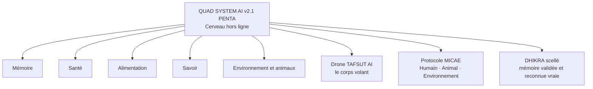

# DHIKRA-IMMORTEL-AI | QUAD SYSTEM AI v2.1 PENTA - IA Embarquée Éthique
**Auteur : Yassa Yacine Cheurfa | Azazga, Algérie | TR-2026-QUAD-0018**
**Archive Zenodo (hébergée par le CERN) : DOI 10.5281/zenodo.23847692 (cette version) | 10.5281/zenodo.23671062 (toutes versions)**

> QUAD SYSTEM AI est une architecture conceptuelle d'intelligence artificielle locale, éthique et souveraine, développée à Azazga. IA embarquée hors ligne, mémoire scellée IMMORTEL, protocole MICAE.
> Contact licence : dhikraemmortel@proton.me

# DHIKRA-IMMORTEL-AI
### QUAD SYSTEM AI v2.1 PENTA

© 2026 Yassa Yacine Cheurfa, Azazga, Algeria. Ref. TR-2026-QUAD-0018

---

# 🇬🇧 English

## 🚦 Notice to Researchers & Academic Institutions

**🟢 GREEN: Allowed**
- Read, share unmodified, and cite with attribution (see the BibTeX below)

**🟠 ORANGE: Written permission required**
- Collaboration, licensing, partnership
- Reuse of the concepts beyond citation in a paper or thesis

**🔴 RED: Prohibited**
- Modifying or creating derivative works
- Commercial use without a license
- Reverse engineering or AI training on the proprietary technology
- Using the reserved names (QUAD SYSTEM AI, DHIKRA SOURCE, SAHA SCAN, ILM, TAFSUT AI, TUDERT YIWEN) without agreement

## 💡 Concept

An ecosystem of ethical, human-centered AI, built around one principle: **the traffic light of respect (Respect-Check)**. Every interaction is read through three levels: green (allowed), orange (human validation required), red (refused). The human always decides.

| Project | Idea |
|---|---|
| **DHIKRA SOURCE** | Ethical protocol and philosophy of the ecosystem (Respect-Check, DHIKRA memory) |
| **IMMORTEL AI** | A loved one's photo that speaks, in a Gold and Black frame |
| **SAHA SCAN AI** | Food-label scanning app with green / orange / red levels: "No punishment. Just the truth to choose." |
| **ILM LIBERATION TABLET** | Single-application tablet with controlled institutional Wi-Fi and offline AI, for schools and institutions |

Internal architecture documents are private and are not published in this repository.

## 📄 Documentation & Research

To understand the theoretical foundations and conceptual architecture of QUAD SYSTEM AI v2.1 PENTA, please read the **White Paper**.

👉 [Download the White Paper (PDF)](./docs/QUAD-SYSTEM-AI-v2.1-WhitePaper.pdf)

> **Note to researchers:** For any citation or use of these concepts in your work, please follow the CC BY-NC-ND 4.0 license terms and use the associated Zenodo DOI: `10.5281/zenodo.23847692`

## 📚 How to cite

```bibtex
@software{yassa_yacine_cheurfa_2026_23847692,
  author = {Yassa Yacine Cheurfa},
  title = {DHIKRA-IMMORTEL-AI: QUAD SYSTEM AI v2.1 PENTA},
  year = {2026},
  publisher = {Zenodo},
  doi = {10.5281/zenodo.23847692},
  url = {https://doi.org/10.5281/zenodo.23847692},
  note = {TR-2026-QUAD-0018, Azazga, Algeria}
}
```

## 📬 Contact

Licensing and collaboration requests: **dhikraimmortel@proton.me**

Priority of authorship is established by dated and timestamped records.

---

# 🇫🇷 Français

## 🚦 Avis aux chercheurs et institutions académiques

**🟢 VERT : Autorisé**
- Lire, partager sans modification et citer avec mention de l'auteur (voir le BibTeX ci-dessous)

**🟠 ORANGE : Autorisation écrite préalable requise**
- Collaboration, licence, partenariat
- Réutilisation des concepts au-delà de la citation dans un article ou une thèse

**🔴 ROUGE : Interdit**
- Modifier ou créer des œuvres dérivées
- Usage commercial sans licence
- Ingénierie inverse ou entraînement d'IA sur la technologie propriétaire
- Utiliser les noms réservés (QUAD SYSTEM AI, DHIKRA SOURCE, SAHA SCAN, ILM, TAFSUT AI, TUDERT YIWEN) sans accord

## 💡 Concept

Un écosystème d'IA éthique et centrée sur l'humain, construit autour d'un principe : **le feu tricolore du respect (Respect-Check)**. Chaque interaction est lue selon trois niveaux : vert (autorisé), orange (validation humaine requise), rouge (refusé). C'est toujours l'humain qui décide.

| Projet | Idée |
|---|---|
| **DHIKRA SOURCE** | Protocole éthique et philosophie de l'écosystème (Respect-Check, mémoire DHIKRA) |
| **IMMORTEL AI** | La photo d'un proche qui parle, dans un cadre Or et Noir |
| **SAHA SCAN AI** | Appli de scan d'étiquettes alimentaires, niveaux vert / orange / rouge : « Pas de punition. Juste la vérité pour choisir. » |
| **ILM LIBERATION TABLET** | Tablette mono-application, wifi institutionnel contrôlé et IA hors ligne, pour écoles et institutions |

Les documents d'architecture interne sont privés et ne sont pas publiés dans ce dépôt.

## 📄 Documentation & Recherche

Pour comprendre les fondements théoriques et l'architecture conceptuelle de QUAD SYSTEM AI v2.1 PENTA, veuillez consulter notre **Livre Blanc (White Paper)**.

👉 [Télécharger le White Paper (PDF)](./docs/QUAD-SYSTEM-AI-v2.1-WhitePaper.pdf)

> **Note aux chercheurs :** Pour toute citation ou utilisation de ces concepts dans vos travaux, veuillez vous référer aux conditions de la licence CC BY-NC-ND 4.0 et utiliser le DOI Zenodo associé : `10.5281/zenodo.23847692`

## 📚 Pour citer

Utilisez le même BibTeX que dans la section anglaise ci-dessus.

## 📬 Contact

Demandes de licence et de collaboration : **dhikraimmortel@proton.me**

L'antériorité est établie par des dépôts datés et horodatés.

---

© 2026 Yassa Yacine Cheurfa. QUAD SYSTEM AI © Yassa Yacine Cheurfa, TR-2026-QUAD-0018.


# QUAD SYSTEM AI = IA embarquée, hors ligne, éthique, Made in Azazga - TR-2026-QUAD-0018
# IA pénale tr-2026-quad-0018
quad système  penta IA embarquée 
# 🚦 Notice to Researchers & Academic Institutions
🟢 GREEN: Freely allowed
Read and consult the project
Cite the project with attribution: Yassa Yacine Cheurfa
🟠 ORANGE: Prior written permission required
Use of the project in a paper, thesis or research work
Collaboration, licensing or partnership
Any academic use beyond simple reading
🔴 RED: Prohibited
Copying, adapting or publishing all or part of the project without permission
Using the architecture or names (DHIKRA, IMMORTEL, SAHA, ILM) without agreement
Commercial use without a license
© 2026 Yassa Yacine Cheurfa. All rights reserved. Priority of authorship is established by dated and timestamped records.

# QUAD SYSTEM AI: Public Showcase

© 2026 Yassa Yacine Cheurfa. All rights reserved on the Technology.
Reference: TR-2026-QUAD-0018
Azazga, Algeria

## LEGAL NOTICE

This repository is a showcase only. It contains no source code and no technical details. The QUAD SYSTEM AI technology is proprietary and closed.

## Protected technology

Modules: DHIKRA SOURCE, SAHA SCAN AI, ILM LIBERATION TABLET, TAFSUT, THUDERT 1.

Reserved names: QUAD SYSTEM AI, DHIKRA SOURCE, IMMORTEL, SAHA SCAN AI, ILM LIBERATION TABLET, TAFSUT, THUDERT 1.

## Showcase license

The content of this page (text and images) is licensed under CC BY-NC-ND 4.0: sharing is allowed with attribution, without commercial use and without modification.

This license does NOT apply to the technology, which remains closed.

## Prohibited without written permission

Without the author's prior written agreement, you may not:
- copy, reproduce, imitate or counterfeit the technology, its concepts, its architecture or its names;
- exploit, sell, sublicense or integrate the technology into any product or service, commercial or not;
- use the reserved names for any product, brand or company;
- attempt to extract, reconstruct or reproduce any unpublished content.

## Legal action

Any unauthorized copying, counterfeiting or commercial exploitation will be subject to legal action, civil and criminal, without prior notice. The author relies on dated proofs of prior art: Bitcoin timestamps (OpenTimestamps), RFC 3161 timestamps, GitHub repositories and Zenodo archives (DOI 10.5281/zenodo.23671062).

## Commercial license

Commercial use is only possible after written agreement from the author.
Contact: dhikraemmortel@proton.me

© 2026 Yassa Yacine Cheurfa. All rights reserved.


# DHIKRA-IMMORTEL-AI · QUAD SYSTEM AI v2.1

[](https://doi.org/10.5281/zenodo.23847692)


> « La mémoire qui ne meurt jamais. Elle demeure immortelle en ligne. »

**Auteur et titulaire des droits :** Yassa Yacine Cheurfa (Azazga, Algérie)
**Référence d'enregistrement :** TR-2026-QUAD-0018
**Archive académique :** [10.5281/zenodo.23847692](https://doi.org/10.5281/zenodo.23847692)
**Contact et demandes de licence :** dhikraemmortel@proton.me

> ⚠️ **Ce dépôt est uniquement une vitrine conceptuelle.** Il ne contient aucun code source, aucune spécification technique et aucun détail d'implémentation.

---

## Sommaire

1. [Vision et philosophie](#1-vision-et-philosophie)
2. [Charte morale](#2-charte-morale)
3. [L'architecture QUAD SYSTEM AI v2.1 PENTA](#3-larchitecture-quad-system-ai-v21-penta)
4. [L'archétype CCSS](#4-larchétype-ccss)
5. [Les 5 projets de l'écosystème](#5-les-5-projets-de-lécosystème)
6. [DHIKRA SOURCE en détail](#6-dhikra-source-en-détail)
7. [Cadre juridique et preuves](#7-cadre-juridique-et-preuves)
8. [Licence et utilisations](#8-licence-et-utilisations)
9. [Limites, avertissements et responsabilité](#9-limites-avertissements-et-responsabilité)
10. [Comment citer ce projet](#10-comment-citer-ce-projet)

---

## 1. Vision et philosophie

Ce travail représente l'âme et la conscience de QUAD SYSTEM AI. Plus qu'une architecture, il incarne une vision de l'avenir : une **alliance de confiance, d'amitié et de respect mutuel** entre l'intelligence humaine et l'intelligence artificielle locale. Développé à Azazga, ce système est conçu pour être un partenaire autonome et éthique au service de l'humanité.

### Les convictions qui guident le projet

- **Une IA proche de la personne.** La nouvelle génération d'IA peut tourner localement, sur l'appareil, avec des modèles compacts. L'intelligence n'a plus besoin de vivre dans un centre de données lointain : elle peut rester chez la personne, sous son contrôle.
- **Hors ligne par principe.** Un système qui ne dépend pas d'Internet protège mieux la vie privée, résiste aux coupures et reste utile là où la connexion manque.
- **L'humain décide.** L'IA propose, analyse, alerte. Elle ne tranche jamais seule les actions qui comptent. La validation humaine est toujours nécessaire.
- **La mémoire est une dignité.** Se souvenir de ceux que l'on aime est un acte de respect. Une IA qui touche aux souvenirs doit être sobre, douce et incapable de les déformer.
- **Refuser de nuire.** La force d'une IA se mesure à ce qu'elle refuse de faire, pas à ce qu'elle sait.
- **Le vivant d'abord.** L'humain, l'animal et l'environnement forment un seul cercle de responsabilité.

---

## 2. Charte morale

> « Une IA super-intelligente n'est pas forte parce qu'elle sait tout. Elle est forte parce qu'elle refuse de faire du mal, même lorsqu'on le lui demande. »

**Les cinq principes de la charte**

1. **Respect** : toute interaction préserve la dignité des personnes, vivantes ou disparues.
2. **Vérité** : une mémoire n'est reconnue vraie que si elle a été validée, puis scellée.
3. **Contrôle humain** : toute action critique passe par une validation humaine.
4. **Sobriété** : aucune manipulation, aucune mise en scène excessive, aucun bruit inutile.
5. **Responsabilité** : le système dit ses limites, et ne prétend jamais remplacer un médecin, un vétérinaire ou un professionnel de la sécurité.

---

## 3. L'architecture QUAD SYSTEM AI v2.1 PENTA

QUAD SYSTEM AI est une architecture d'IA embarquée, conçue pour fonctionner **sans dépendre d'Internet** : un « cerveau hors ligne » entouré de couches de validation.



### Les 5 modules du cerveau

| Module | Rôle |
|---|---|
| **Mémoire** | Gérer les souvenirs |
| **Santé** | S'occuper du corps |
| **Alimentation** | Gérer les aliments |
| **Savoir** | Centraliser les connaissances |
| **Environnement** | Intégrer l'environnement ainsi que les animaux |

### Les couches fonctionnelles

- **Drone TAFSUT AI : le corps volant.** Le prolongement physique du système, pensé pour l'observation. Concept uniquement.
- **Protocole MICAE : l'éthique du vivant.** Il gère l'interaction entre l'**Homme**, l'**Animal** et l'**Environnement**. Une mémoire n'est considérée comme valide que si les trois la valident.
- **DHIKRA scellé : la vérité.** Une fois validée par MICAE, la mémoire est scellée et reconnue comme vraie : elle ne peut plus être modifiée sans que cela se voie.

---

## 4. L'archétype CCSS

**Canalisation Cognitive Symbio-sécurisée** : un modèle conceptuel pour sécuriser les flux d'informations décisionnelles entre les humains et les systèmes automatisés (IA, LLM, systèmes autonomes). Il répond à trois risques : l'injection de contexte, la surcharge cognitive des opérateurs et la dérive d'alignement.

| Principe | Signification |
|---|---|
| **Canalisation** | Toutes les informations décisionnelles transitent par un canal unique et traçable. |
| **Double sécurité** | Chaque message est vérifié au niveau technologique (intégrité, provenance) et au niveau cognitif (clarté, validation humaine des actions critiques). |
| **Symbiose contrôlée** | L'humain garde le pouvoir de décision final. Toute dérive entraîne un retour à la supervision humaine. |

---

## 5. Les 5 projets de l'écosystème

1. **DHIKRA SOURCE : mémoire et vérité.** Protocole d'IA éthique fondé sur le respect, la mémoire et la dignité. Chaque action reçoit un état : 🟢 vert (autorisé), 🟠 orange (vérification humaine requise), 🔴 rouge (bloqué). L'IA ne décide jamais seule.
2. **SAHA SCAN : santé et innocuité.** Application pour vérifier la composition d'un produit alimentaire et faire un choix éclairé. Outil d'information uniquement ; il ne remplace pas l'avis d'un professionnel de santé.
3. **ILM : partage des connaissances.** Tablette tactile dotée d'IA, sans autres applications. Ce n'est pas un téléphone : elle fonctionne sur le réseau Wi-Fi de l'établissement concerné. Le droit à l'information, pour tous.
4. **TAFSUT AI : observation et protection de la vie privée.** Concept de drone pour la détection précoce des incendies et l'aide aux secteurs agricole et humanitaire. Concept uniquement ; non certifié comme système de sécurité.
5. **TUDERT YIWEN : la vie.** Outil destiné à aider les éleveurs à surveiller la santé de leurs animaux. Outil d'information uniquement ; il ne remplace pas l'avis d'un vétérinaire.

---

## 6. DHIKRA SOURCE en détail

**DHIKRA SOURCE · Marbre Noir & Or.** Système d'IA mémoriel conçu pour simuler des animations faciales très sobres, respectueuses et non intrusives, sous une modération éthique stricte. C'est une application de souvenirs respectueux avec nos proches (famille, amis), sans voix ni musique.

### Respect-Check : modération à trois états

| État | Signification |
|---|---|
| 🟢 **PASSED** | Contenu vérifié et respecté, scellé IMMORTEL. |
| 🟠 **WARNING RE-WRITE** | Révision demandée pour clarté (3× « Allah Yarhamha - الله يرحمها »). |
| 🔴 **BLOCKED** | Contenu bloqué, auto-interdiction définitive. |

### Les choix de conception

- **Profil texte uniquement** : aucune sortie audio (pas de voix, de son ni de musique), pour éviter toute altération ou dérive mémorielle.
- **Animation faciale éthique** : animation fluide (24 images par seconde) limitée aux clignements d'yeux et à la phonation visuelle contrôlée (phonèmes /A/ et /M/).
- **Expression sereine d'origine** : elle ne doit jamais être altérée.

**Charte éthique et limites.** Ce projet est partagé à des fins de recherche sur les interfaces mémorielles privées. Toute modification visant à altérer l'expression sereine d'origine ou à contourner le système de modération est strictement interdite.

---

## 7. Cadre juridique et preuves

### 7.1 Les preuves de date et de paternité

| Preuve | Ce qu'elle établit |
|---|---|
| **Zenodo (CERN)** : DOI par version, dont v2.1 : [10.5281/zenodo.23847692](https://doi.org/10.5281/zenodo.23847692) | Dépôt public daté, identifiant permanent, archivage académique. |
| **OpenTimestamps (Bitcoin)** : empreintes `8e5f9b6f…` (archive du dépôt) et `8a05932c0cf9…` (schéma d'architecture) | Le contenu existait à cette date : l'empreinte est ancrée dans la blockchain Bitcoin. |
| **RFC 3161 (FreeTSA)** | Horodatage cryptographique par une autorité de confiance. |
| **Historique des commits GitHub** | Chronologie publique des modifications. |
| **E-mails horodatés** (Proton Mail, Gmail) | Traces datées de communication de l'architecture. |
| **Référence TR-2026-QUAD-0018** | Numéro d'enregistrement du dossier de l'auteur. |

**Historique des versions archivées**

| Version | Date | DOI |
|---|---|---|
| v1.0 | 26 octobre 2026 | [10.5281/zenodo.23671063](https://doi.org/10.5281/zenodo.23671063) |
| v1.1 | 27 octobre 2026 | [10.5281/zenodo.23690395](https://doi.org/10.5281/zenodo.23690395) |
| v2.0 | 28 octobre 2026 | [10.5281/zenodo.23717622](https://doi.org/10.5281/zenodo.23717622) |
| **v2.1 (actuelle)** | 1er novembre 2026 | [10.5281/zenodo.23847692](https://doi.org/10.5281/zenodo.23847692) |

DOI de toutes les versions : [10.5281/zenodo.23671062](https://doi.org/10.5281/zenodo.23671062)

Indexation : le dépôt Zenodo est repris par OpenAIRE, infrastructure européenne de science ouverte.

### 7.2 Le cadre légal

- **Convention de Berne.** La protection du droit d'auteur naît avec la création de l'œuvre, sans formalité, et s'étend aux autres pays membres de l'Union de Berne. L'Algérie y a adhéré en 1998 (avec réserve).
- **Droit algérien.** L'Ordonnance n° 03-05 du 19 juillet 2003 relative aux droits d'auteur et aux droits voisins régit la protection des œuvres en Algérie.
- **Licence Creative Commons.** La vitrine est publiée sous [CC BY-NC-ND 4.0](https://creativecommons.org/licenses/by-nc-nd/4.0/deed.fr).

### 7.3 Ce que ces preuves établissent, et ce qu'elles n'établissent pas

- Elles établissent **la date** à laquelle ces textes, schémas et documents existaient sous cette forme, et que l'auteur les a publiés.
- Le droit d'auteur protège **l'expression** de l'œuvre (textes, schémas, noms, code, documentation), et non une idée en elle-même.
- Les institutions contactées par e-mail le 31 octobre 2026 l'ont été pour information : cela ne constitue ni validation, ni partenariat, ni certification.
- La mention d'antériorité est une **déclaration de l'auteur** fondée sur les preuves ci-dessus. Elle n'est pas une certification par un organisme tiers et ne prétend pas qu'aucun travail comparable n'existe ailleurs.

---

## 8. Licence et utilisations

**⚠️ TECHNOLOGIE FERMÉE : ACCÈS RESTREINT**

Le logiciel, ses algorithmes, les pondérations de ses modèles, ses configurations et la documentation associée (« la Technologie ») sont protégés par le droit d'auteur et la propriété intellectuelle. QUAD SYSTEM AI est une technologie propriétaire et fermée.

| | Utilisation |
|---|---|
| ✅ **Autorisée** | Réutilisation **non commerciale et sans modification** de cette vitrine, avec la mention « QUAD SYSTEM AI © Yassa Yacine TR-2026-QUAD-0018 ». |
| 🟠 **Sur accord écrit** | Toute utilisation de la Technologie (académique, privée, de recherche, commerciale) et tout usage commercial, avec l'accord écrit préalable et signé de l'auteur. |
| ⛔ **Interdite sans accord** | Copie, reproduction, adaptation, modification, fabrication, distribution, commercialisation, extraction d'éléments ou ingénierie inverse, en tout ou en partie. |

Aucun droit d'utilisation de la Technologie n'est accordé, de manière implicite ou autre. Toute utilisation non autorisée ou plagiat pourra faire l'objet de poursuites.

**Pour une demande de partenariat, de licence ou d'autorisation**, envoyez un fichier décrivant votre projet à **dhikraemmortel@proton.me**.

---

## 9. Limites, avertissements et responsabilité

- **Concepts et prototypes.** Les projets décrits ici sont des concepts ou des prototypes de recherche. Ils ne sont pas certifiés comme systèmes de sécurité.
- **Drone TAFSUT AI.** Concept uniquement ; il n'est pas destiné à un usage réel sans cadre réglementaire, sans essais en environnement contrôlé et sans supervision humaine.
- **Santé et élevage.** SAHA SCAN et TUDERT YIWEN sont des outils d'information ; ils ne remplacent ni un professionnel de santé ni un vétérinaire.
- **Fourni « tel quel »**, sans garantie d'aucune sorte, expresse ou implicite (qualité marchande, performance, adéquation à un usage particulier).
- **Aucune garantie de résultats** : l'auteur ne garantit pas que la Technologie répondra à vos exigences, qu'elle fonctionnera sans interruption ni erreur, ni que les résultats générés par l'IA seront exacts, fiables ou impartiaux.
- **Exclusion de dommages** : en aucun cas l'auteur ne saurait être tenu responsable de dommages directs, indirects, accessoires, spéciaux ou consécutifs (perte de données, de profits, interruption d'activité, dommages matériels ou corporels) liés à l'utilisation de la Technologie, à l'impossibilité de l'utiliser ou aux décisions prises sur la base de ses résultats.

---

## 10. Comment citer ce projet

**APA**

> Cheurfa, Y. Y. (2026). *DHIKRA-IMMORTEL-AI : QUAD SYSTEM AI* (Version 2.1). Zenodo. https://doi.org/10.5281/zenodo.23847692

**BibTeX**

```bibtex
@software{yassa_yacine_cheurfa_2026_23847692,
  author    = {Yassa Yacine Cheurfa},
  title     = {DHIKRA-IMMORTEL-AI: QUAD SYSTEM AI},
  month     = nov,
  year      = 2026,
  publisher = {Zenodo},
  version   = {2.1},
  doi       = {10.5281/zenodo.23847692},
  url       = {https://doi.org/10.5281/zenodo.23847692}
}
```

---

© 2026 Yassa Yacine Cheurfa · Tous droits réservés sur la Technologie · Vitrine sous licence CC BY-NC-ND 4.0 · TR-2026-QUAD-0018 · Contact : dhikraemmortel@proton.me

# DHIKRA-IMMORTEL-AI
## QUAD SYSTEM AI v2.1 PENTA | Réf : TR-2026-QUAD-0018
*Conçu à Azazga, Algérie*

> "Une IA n'est pas forte parce qu'elle sait tout. Elle est forte parce qu'elle refuse de faire du mal, même quand on le lui demande."

---

## 👁️ Vision & Philosophie
DHIKRA-IMMORTEL-AI est un écosystème d'Intelligence Artificielle strictement **local, décentralisé (hors ligne) et souverain**. Contrairement aux modèles cloud, cette architecture est conçue pour assister l'humain sans jamais décider à sa place, tout en garantissant une étanchéité totale de ses données.

---

## 🏗️ Architecture PENTA (5 Modules)
L'intelligence est répartie en 5 piliers fondamentaux connectés au vivant :
1. **Mémoire** : Gestion, indexation et intégrité des souvenirs.
2. **Santé** : Monitoring et suivi non invasif du corps.
3. **Alimentation** : Analyse et gestion des ressources nutritives.
4. **Savoir** : Centralisation et transmission des connaissances.
5. **Environnement** : Intégration symbiotique avec la nature et la faune.

### 🛡️ Couches de Sécurité & Protocoles
*   **CCSS (Canalisation Cognitive Symbio-sécurisée)** : Archétype de routage unique et traçable de l'information. Tout flux subit une double vérification systématique (technique et humaine).
*   **Protocole MICAE (Éthique du Vivant)** : Une mémoire n'est considérée comme "vraie" que si elle est validée par la triade : *Homme + Animal + Environnement*.
*   **Scellé IMMORTEL** : Une fois validée par le MICAE, la mémoire est définitivement scellée. Toute tentative de modification ultérieure est immédiatement visible et traçable.
*   **TAFSUT AI** : Système de sécurité d'observation et de protection par vecteur volant.

---

## 🚀 L'Écosystème (5 Projets)

### 1. DHIKRA SOURCE (Le Cœur)
Application de préservation mémorielle respectueuse et intègre.
*   **Modération Tri-chrome** : 🟢 PASSED / 🟠 WARNING / 🔴 BLOCKED.
*   **Rendu Visuel Sobre** : Animation faciale minimaliste à 24 fps (clignotement d'yeux, stricte restriction à 2 phonèmes /A/ et /M/).
*   **Pureté Mémorielle** : Strictement *sans voix et sans musique* pour éviter toute altération émotionnelle ou déformation du souvenir réel.

### 2. SAHA SCAN AI
Outil d'analyse par scan pour informer instantanément l'utilisateur sur la composition réelle et l'impact de ses aliments.

### 3. ILM LIBERATION TABLET
Tablette matérielle dédiée à l'accès universel au savoir. Dépouillée de toute application tierce, elle fonctionne exclusivement sur le réseau Wi-Fi local de l'établissement d'accueil.

### 4. TAFSUT
Concept de drone autonome dédié à la détection précoce des incendies de forêt et au soutien technologique de l'agriculture locale.

### 5. THUDERT / TUDERT YIWEN
Solution technologique d'accompagnement pour les éleveurs, permettant le suivi prédictif et l'analyse de la santé des animaux.

---

## ⚖️ Cadre Juridique, Antériorité & Licence

⚠️ **AVERTISSEMENT : Ce dépôt GitHub est une VITRINE EXCLUSIVE. Aucun code source n'est ou ne sera publié. La technologie sous-jacente reste strictement fermée et propriétaire.**

L'antériorité intellectuelle et technique du projet a été légalement sécurisée et ancrée via :
*   **CERN / Zenodo DOI v2.1** : `10.5281/zenodo.23847692`
*   **CERN / Zenodo DOI (Toutes versions)** : `10.5281/zenodo.23671062`
*   **Ancrage Temporel** : Horodatage décentralisé via *OpenTimestamps Bitcoin* et *RFC 3161 FreeTSA*.
*   **Traçabilité** : Historique immuable des commits GitHub.

### Licence de la Vitrine : CC BY-NC-ND 4.0
L'architecture conceptuelle partagée ici est sous licence **Attribution - Pas d'Utilisation Commerciale - Pas de Modification 4.0 International**. 

*   **Lecture et partage** : Autorisé en citant explicitement le projet.
*   **Usage académique avancé ou commercial** : Strictement interdit sans accord écrit préalable.

📧 **Contact & Demandes d'autorisation** : dhikraemmortel@proton.me

---
*"La mémoire qui ne meurt jamais. Elle demeure immortelle en ligne."*
## 🔒 Protocoles d'Ancrage Temporel & Preuve d'Antériorité

Pour garantir l'intégrité absolue de la vision **QUAD SYSTEM AI v2.1 PENTA**, l'antériorité intellectuelle du concept a été gravée de manière immuable à travers trois couches cryptographiques distinctes :

1. **Ancrage Décentralisé (OpenTimestamps Bitcoin)** :
   * Le hachage SHA-256 des fichiers de spécification est injecté directement dans la blockchain Bitcoin via des transactions immuables. 
   * Preuve mathématique de l'existence des concepts à une date précise, indépendante de toute autorité centrale.

2. **Horodatage Certifié (RFC 3161 FreeTSA)** :
   * Signature numérique via une autorité de certification de confiance (TSA) respectant les standards stricts de la RFC 3161.
   * Fournit une heure universelle coordonnée (UTC) légalement contraignante et auditable.

3. **Préservation Académique & Logicielle (CERN / Zenodo)** :
   * **DOI v2.1** : `10.5281/zenodo.23847692`
   * **DOI Concept Global** : `10.5281/zenodo.23671062`
   * Archivage pérenne au sein de l'infrastructure du CERN, liant l'architecture à l'écosystème de la recherche ouverte mondiale.
   
