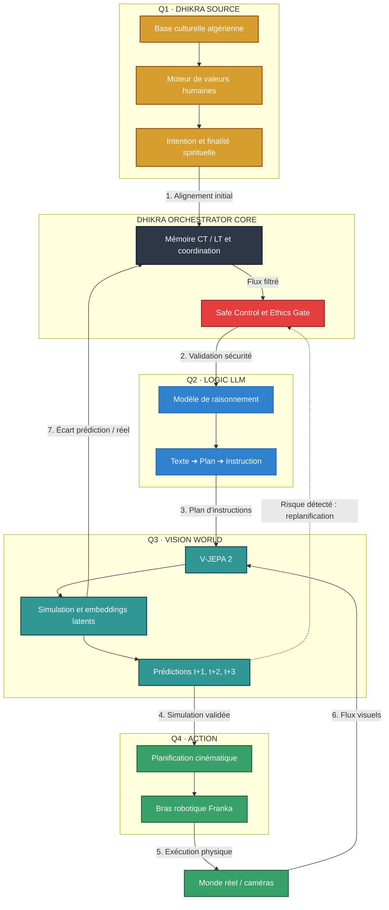

# DHIKRA QUAD SYSTEM AI

## Architecture d'IA souveraine, hors ligne et éthique par construction

**Fiche technique de référence : TR-2026-QUAD-0018** — Fait à Azazga, le 04 novembre 2026
**Version du document :** 2.3 · **Mise à jour :** 05 novembre 2026
**Nature :** vitrine publique académique — *sans code source, sans détail de fabrication*

| Champ | Valeur |
|---|---|
| Auteur et titulaire des droits | Yassa Yacine Cheurfa |
| Affiliation | Chercheur indépendant, Azazga, Kabylie, Algérie |
| ORCID | [0009-0005-1982-7176](https://orcid.org/0009-0005-1982-7176) |
| DOI (version 2.3) | [10.5281/zenodo.23964487](https://doi.org/10.5281/zenodo.23964487) |
| DOI (toutes versions) | [10.5281/zenodo.23671062](https://doi.org/10.5281/zenodo.23671062) |
| Licence de la vitrine | CC BY-NC-ND 4.0 (ne couvre pas la technologie) |
| Contact (licences, collaborations) | dhikraemmortel@proton.me |

> « DHIKRA = Mémoire scellée. SOURCE = Souveraineté. »

---

## Résumé

Ce document présente **DHIKRA QUAD SYSTEM AI**, une architecture d'intelligence artificielle conçue pour fonctionner **hors ligne** et soumise à un **filtre éthique à trois états (Respect-Check)** qui précède toute action ou toute saisie. Le système articule quatre quadrants fonctionnels (**SOURCE**, **LOGIC**, **VISION**, **ACTION**) autour d'un noyau orchestrateur doté d'une mémoire à court et long terme et d'une passerelle de sécurité (*Safe Control & Ethics Gate*). Sa contribution revendiquée n'est pas l'invention des briques technologiques, mais **leur assemblage autour d'une contrainte morale inscrite dans l'architecture** et d'une **gouvernance par consentement communautaire**. Le document précise le périmètre des revendications, le régime de propriété intellectuelle, les preuves d'antériorité et les limites identifiées par l'auteur lui-même.

**Mots-clés :** IA éthique par conception ; IA hors ligne ; consentement communautaire ; mémoire scellée ; traçabilité ; souveraineté des données ; modèle du monde ; IA incarnée.

---

## Table des matières

1. Introduction et problématique
2. Principes de la fiche TR-2026-QUAD-0018
3. Déclaration des revendications
4. Architecture générale
5. Flux de données et boucle de rétroaction
6. Respect-Check et matrice tricolore
7. Gouvernance et consentement communautaire
8. Écosystème de projets
9. Positionnement et état de l'art
10. Propriété intellectuelle et licences
11. Preuves d'antériorité et versions
12. Analyse critique : tensions et limites
13. Perspectives et recommandations
14. Glossaire
15. Références
16. Comment citer
17. Mentions légales

---

## 1. Introduction et problématique

Les approches dominantes de l'« alignement » ajoutent des garde-fous *a posteriori* à des modèles déjà puissants. DHIKRA QUAD SYSTEM AI part du principe inverse : **la contrainte précède la capacité**. Une IA ne doit pas faire de mal « par construction », et non en vertu d'une règle surajoutée.

**Problématique.** Comment concevoir un système d'IA dont la limite morale est inscrite dans l'architecture, dont les décisions sont traçables, et dont l'usage est subordonné au consentement de la communauté concernée ?

**Fondements.**

- **Éthique par construction** : le filtre agit avant la génération et avant l'action.
- **La mémoire comme responsabilité** : DHIKRA (remémoration). Une mémoire n'est reconnue comme valide qu'après validation puis scellage ; toute modification devient visible.
- **Non-punition** : l'outil éclaire, la personne décide.
- **Respect élargi (MICAE)** : Humain, Animal, Environnement.
- **Souveraineté et communauté** : les données et les décisions restent dans la communauté concernée (principe de conception : aucune donnée ne quitte le cercle familial via la Tablette ILM).

---

## 2. Principes de la fiche TR-2026-QUAD-0018

La fiche de référence **TR-2026-QUAD-0018** fixe le cadre dans lequel DHIKRA QUAD SYSTEM AI est décrit, publié et protégé. Elle repose sur sept principes.

| N° | Principe | Énoncé |
|---|---|---|
| P1 | **Vitrine sans source** | Seule la description académique est publique ; aucun code source ni détail de fabrication n'est divulgué. |
| P2 | **Technologie propriétaire et fermée** | Aucun droit d'exploitation n'est concédé par défaut. |
| P3 | **Séparation des régimes** | La vitrine (CC BY-NC-ND 4.0) est distincte de la technologie, qu'elle ne couvre pas. |
| P4 | **Noms réservés** | QUAD SYSTEM AI, DHIKRA SOURCE, IMMORTEL AI, SAHA SCAN AI, ILM LIBERATION TABLET, TAFSUT AI, TUDERT YIWEN. |
| P5 | **Antériorité datée, non unicité** | Un dépôt daté prouve l'existence d'un contenu à une date donnée, non l'unicité de l'idée. |
| P6 | **Revendications bornées** | Le projet distingue explicitement ce qu'il revendique de ce qu'il ne revendique pas (§3). |
| P7 | **Aucune performance garantie** | Les valeurs chiffrées sont des cibles de conception, non des mesures. |

---

## 3. Déclaration des revendications

### 3.1 Ce qui est revendiqué

1. **Le système conçu** : une architecture d'IA hors ligne dont un filtre éthique à trois états (Respect-Check) précède toute action ou saisie.
2. **La philosophie** : l'éthique par construction plutôt que par règle ajoutée.
3. **La charte d'accord** : la communauté concernée décide ; tout usage raisonnable suppose son consentement.
4. **L'implémentation** : l'intégration de la matrice tricolore dans l'application elle-même, associée à une gouvernance communautaire et à un fonctionnement hors ligne.
5. **La paternité** de cet ensemble par Yassa Yacine Cheurfa, avec les preuves datées associées.

### 3.2 Ce qui n'est pas revendiqué

- Le fait d'être le premier à employer trois couleurs pour encadrer l'usage de l'IA : des dispositifs analogues existent, notamment dans l'enseignement supérieur.
- L'invention du drone de détection d'incendie, du réseau LoRa ou de l'IA embarquée.
- L'unicité d'une idée du seul fait d'un dépôt daté.
- Toute performance technique garantie à ce stade.

---

## 4. Architecture générale

### 4.1 Vue d'ensemble

L'architecture se compose d'un **noyau central** et de **quatre quadrants**.



*Figure 1 — Architecture fonctionnelle et flux de données (7 étapes et boucle de replanification).*

Poster interactif : [poster.html](poster.html)

### 4.2 Noyau central : DHIKRA Orchestrator Core

| Composant | Fonction |
|---|---|
| Hub de coordination | Gestion des flux de décision globaux entre modules |
| Mémoire CT / LT | Tampon à court terme et mémoire longue ; synchronisation des embeddings latents ; historique des écarts prédiction/réel |
| **Safe Control & Ethics Gate** | Verrou de validation systématique entre les modules : vérifie l'intention, les barrières anti-collision et les contraintes culturelles ; bloque ou replanifie en cas de risque |

### 4.3 Les quatre quadrants

| Quadrant | Rôle | Composants et capacités |
|---|---|---|
| **Q1 · SOURCE DHIKRA** | Alignement des valeurs et ancrage contextuel | Moteur de valeurs humaines (éthique universelle et locale) ; couche d'intention, de finalité et de responsabilité sociétale ; base de connaissances sur le patrimoine algérien. Porte la mémoire scellée et le protocole RAHMA. |
| **Q2 · LOGIC LLM** | Cognition et planification | Grand modèle de langage optimisé pour le raisonnement : dialogue, logique formelle, synthèse, questions-réponses contextuelles. Traduit le texte brut en plans structurés (Texte ➔ Plan ➔ Instruction). Moteur de raisonnement MICAE, visé hors ligne (Edge AI). |
| **Q3 · VISION WORLD** | Perception et modèle du monde | V-JEPA 2 (Meta), apprentissage visuel prédictif sans étiquetage humain ; modélisation du monde, embeddings latents, anticipation des états futurs (t+1, t+2, t+3). |
| **Q4 · ACTION** | Exécution incarnée | Bras robotique Franka (Franka Robotics) ; planification cinématique, manipulation de précision, interaction physique ; exécution sécurisée via la Tablette ILM et le protocole CCSS. |

### 4.4 Modules complémentaires

- **Cinq modules PENTA** : mémoire, santé, savoir, environnement, alimentation.
- **Trois modules exécutifs** : drone TAFSUT AI, protocole MICAE, DHIKRA SCELLÉE.

---

## 5. Flux de données et boucle de rétroaction

| Étape | Transition | Description |
|---|---|---|
| 1 | SOURCE → Core | **Alignement initial** : filtres éthiques, culturels et d'intention appliqués à la tâche. |
| 2 | Core → Gate → LOGIC | **Validation sécuritaire** : passage obligatoire par le *Safe Control & Ethics Gate*. |
| 3 | LOGIC → VISION | **Planification** : décomposition en plan d'instructions structurées. |
| 4 | VISION → ACTION | **Simulation et anticipation** : résultat simulé, collisions anticipées. Si un risque est détecté, **replanification** via l'Ethics Gate. |
| 5 | ACTION → Monde réel | **Exécution physique** de l'action validée. |
| 6 | Monde réel → VISION | **Capture** des flux visuels réels. |
| 7 | VISION → Core | **Rétroaction** : calcul de l'écart prédiction/réalité, renvoyé au noyau pour auto-correction et apprentissage. |

**Propriété de sûreté visée (fail-closed).** En cas d'absence de validation ou d'incertitude, le système se bloque par défaut. Cette propriété est un objectif de conception à démontrer (voir §13).

---

## 6. Respect-Check et matrice tricolore

**Principe énoncé :** aucune génération n'a lieu sans Respect-Check validé. Le filtre est intégré à l'identité visuelle (dans la lettre « I » du typogramme DHIKRA).

| État | Effet sur le clavier / la saisie | Effet sur le drone / l'action |
|---|---|---|
| 🟢 **Vert** | Autorisation | Transmission autorisée |
| 🟠 **Orange** | Réécriture exigée (formule rituelle répétée trois fois) | Réduction de vitesse ou validation contextuelle |
| 🔴 **Rouge** | Blocage | Interruption immédiate |

**Choix de retenue : la photo vivante (IMMORTEL AI).** L'animation est limitée à un clignement naturel des yeux et à un mouvement de bouche doux (/A/ et /M/, au moins 24 images par seconde), **sans voix, sans son, sans musique**, avec préservation de l'expression d'origine. Ce choix réduit les risques de falsification d'identité et d'usurpation.

---

## 7. Gouvernance et consentement communautaire

La communauté concernée décide. Un usage raisonnable suppose son consentement, exprimé par un **conseil local** via la Tablette ILM :

- **Vert** : autorisé.
- **Orange** : validation par le conseil.
- **Rouge** : interdit.

Un **droit d'opposition avant scellage** est prévu pour les traces individuelles. Cette gouvernance constitue la contribution la plus distinctive du projet : elle **déplace la question éthique de la machine vers l'institution qui l'encadre**.

---

## 8. Écosystème de projets

| Projet | Fonction |
|---|---|
| DHIKRA SOURCE | Protocole éthique, cœur du système |
| IMMORTEL AI | Photo vivante, mémoire commémorative |
| SAHA SCAN AI | Santé et analyse alimentaire |
| ILM LIBERATION TABLET | Savoir libre, tablette hors ligne |
| TAFSUT AI | Détection précoce d'incendie par drone |
| TUDERT YIWEN | Protection de la vie (élevage) |

---

## 9. Positionnement et état de l'art

**Contribution propre :** l'ingénierie de la contrainte éthique et souveraine par construction.

1. **L'éthique dans l'interface** : filtre tricolore imbriqué dans le typogramme ; blocage ou guidage au niveau de la saisie.
2. **Le consensus local** : validation par un conseil via la Tablette ILM, pour une IA déconnectée (*air-gapped*).
3. **Le triptyque MICAE** : Humain, Animal, Environnement, avec scellage par empreinte cryptographique à intégrité vérifiable.
4. **La dignité mémorielle** : sobriété d'IMMORTEL AI (mouvements subtils, pas de clonage vocal).

**Briques existantes intégrées sans prétention d'invention :** infrastructures matérielles (drones, réseaux LoRa), modèles de langage légers exécutables localement, registres d'audit standard, codes colorimétriques de vigilance, modèles du monde de type JEPA.

**Formulation de la contribution :** *une implémentation originale qui intègre le feu tricolore dans l'application elle-même, associée à une gouvernance communautaire et à un fonctionnement hors ligne.*

---

## 10. Propriété intellectuelle et licences

| Élément | Régime |
|---|---|
| Technologie | Propriétaire et fermée ; aucun droit d'exploitation concédé par défaut |
| Vitrine et documentation | CC BY-NC-ND 4.0 (ne couvre pas la technologie) |
| Logos officiels et glossaire | À préciser par l'auteur |
| Noms réservés | Voir principe P4 |

**Autorisation écrite préalable requise** pour toute collaboration, licence d'exploitation ou utilisation dans un autre projet. **Interdits sans licence écrite :** modification du principe original, contrefaçon, exploitation commerciale, ingénierie inverse.

**Feu tricolore des usages pour les chercheurs**

| État | Usage |
|---|---|
| 🟢 Vert | Lecture et citation libres, avec attribution |
| 🟠 Orange | Autorisation écrite préalable requise |
| 🔴 Rouge | Interdit : copie, ingénierie inverse, exploitation commerciale |

*Cette section décrit les choix du projet ; elle ne constitue pas un avis juridique.*

---

## 11. Preuves d'antériorité et versions

Un dépôt Zenodo établit qu'un document existait à une date donnée ; il ne prouve ni l'unicité de l'idée ni, à lui seul, la paternité. La paternité est **revendiquée, avec les preuves datées associées** (dépôts Zenodo, horodatages, dépôts GitHub, fichiers d'origine).

| Version | DOI | Description |
|---|---|---|
| **2.3 (actuelle)** | 10.5281/zenodo.23964487 | Vitrine réorganisée |
| 2.2 | 10.5281/zenodo.23944074 | Section 0, glossaire, logo du pack baroque |
| 2.1 | 10.5281/zenodo.23847692 | Antériorité de la vitrine |
| Toutes versions | 10.5281/zenodo.23671062 | DOI de concept |

---

## 12. Analyse critique : tensions et limites

Par rigueur académique, l'auteur expose lui-même les questions ouvertes du projet.

1. **Qui définit le mal ?** Une taxonomie explicite du vert, de l'orange et du rouge, avec justification, est nécessaire.
2. **Protection et autonomie.** L'énoncé « le Respect-Check contrôle le clavier » doit être concilié avec « l'IA ne décide pas seule ».
3. **Mémoire non supprimable.** Elle s'oppose au droit à l'effacement de nombreux régimes de protection des données ; la procédure de retrait d'une mémoire scellée reste à préciser.
4. **Personnes disparues.** Un protocole de consentement des ayants droit renforcerait la retenue du dispositif.
5. **Universalité des formules.** L'état orange exige une formule rituelle ; une variante neutre peut être envisagée.
6. **Exactitude des affirmations techniques.**
   - « 100 % hors ligne » exige une architecture matérielle précise (isolement réseau, absence de mises à jour distantes).
   - Un journal à intégrité vérifiable par empreintes est plus exact qu'un « registre infalsifiable ».
   - Le floutage automatique ne peut être garanti à 100 %.
   - Les spécifications du drone doivent être mises en cohérence physique, et son vol est soumis à autorisation.
   - Les valeurs telles que latence < 40 ms ou contexte de 128 k sont des **cibles**, non des mesures.
7. **Cohérence terminologique.** « Feu tricolore pénal » et « non-punition » gagneraient à être réconciliés.
8. **Cohérence d'architecture.** L'intégration d'un modèle de vision et d'un bras robotique à un système « 100 % hors ligne » suppose un déploiement local de tous les modèles, à spécifier.

---

## 13. Perspectives et recommandations

- Démonstration vidéo datée des trois états du Respect-Check.
- Taxonomie publique du vert, de l'orange et du rouge.
- Protocole de consentement (communauté, ayants droit).
- Spécification technique minimale, sans divulgation des secrets de fabrication.
- Protocole d'évaluation du comportement *fail-closed* (scénarios de test, critères de réussite).
- Relecture externe par un chercheur en éthique de l'IA ou en droit du numérique.

**Conclusion.** La valeur principale du projet n'est pas d'avoir inventé les briques, mais de les **assembler** autour d'une gouvernance locale et d'une philosophie du refus, ancrées dans un contexte culturel précis.

---

## 14. Glossaire

| Terme | Définition |
|---|---|
| DHIKRA | Principe de mémoire validée puis scellée (remémoration) |
| SOURCE | Module d'alignement culturel et éthique ; souveraineté |
| Respect-Check | Filtre éthique à trois états contrôlant ce qui peut passer |
| Feu tricolore | Matrice vert, orange, rouge du Respect-Check |
| MICAE | Protocole de validation Humain-Animal-Environnement |
| PENTA | Cinq modules : mémoire, santé, savoir, environnement, alimentation |
| Scellage | Consignation rendant toute modification visible |
| CCSS | Contrôle, Certification et Scellage Sécurisé |
| ILM | Tablette locale de savoir et de supervision |
| RAHMA | Protocole associé à la mémoire scellée du quadrant SOURCE |
| V-JEPA 2 | Modèle vidéo prédictif de Meta (représentations latentes) |
| Fail-closed | Blocage par défaut en l'absence de validation |

---

## 15. Références

*Références indicatives, à vérifier avant citation formelle.*

1. Assran, M., Bardes, A., Fan, D., Garrido, Q., Howes, R. et al. (2025). *V-JEPA 2: Self-Supervised Video Models Enable Understanding, Prediction and Planning.* arXiv:2506.09985.
2. UNESCO (2021). *Recommandation sur l'éthique de l'intelligence artificielle.*
3. Parlement européen et Conseil (2024). Règlement (UE) 2024/1689 sur l'intelligence artificielle.
4. Parlement européen et Conseil (2016). Règlement (UE) 2016/679 (RGPD), art. 17 (droit à l'effacement).
5. ISO/IEC 42001:2023. *Systèmes de management de l'intelligence artificielle.*
6. University College Dublin, College of Arts and Humanities (2024). *Traffic Light System for Generative AI Use in Module Assignments* (rouge / orange / vert). https://www.ucd.ie/artshumanities/study/aifutures/trafficlightsystem

---

## 16. Comment citer

**APA**

> Cheurfa, Y. Y. (2026). *DHIKRA-IMMORTEL-AI : QUAD SYSTEM AI* (version 2.3) [Vitrine logicielle]. Zenodo. https://doi.org/10.5281/zenodo.23964487

**BibTeX**

```bibte


